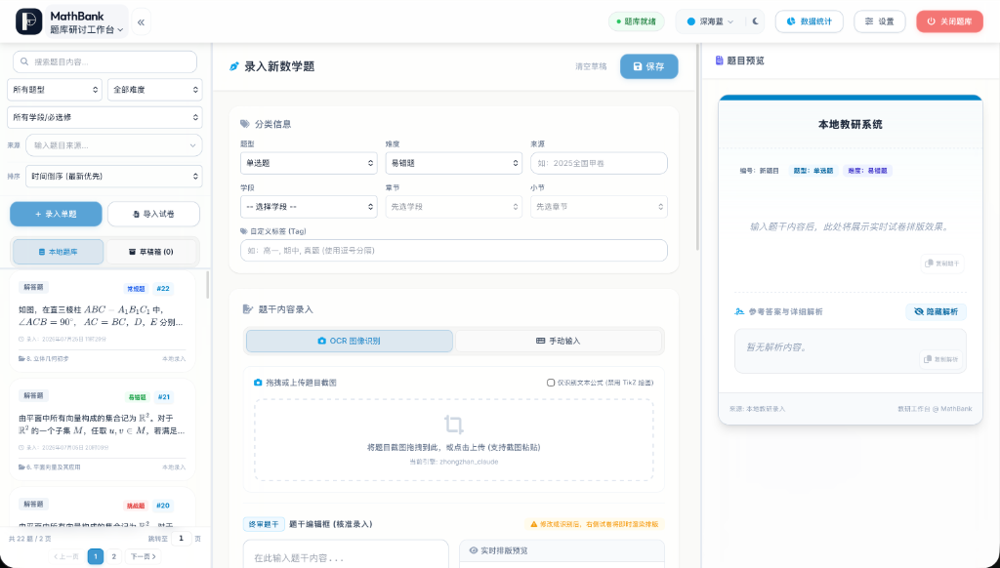
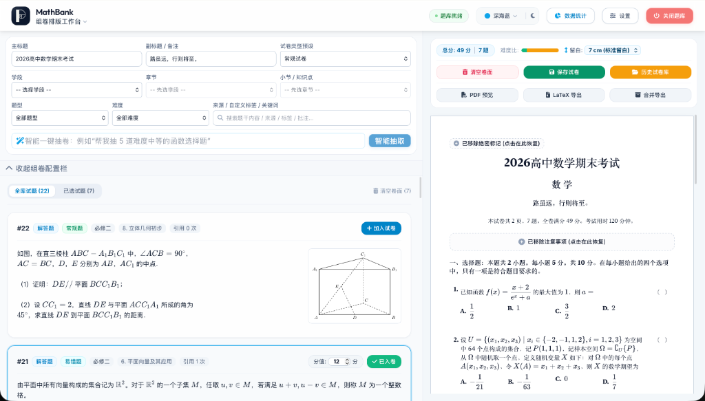
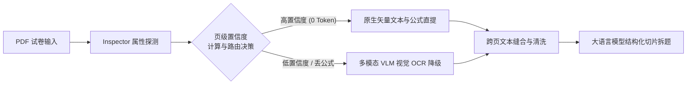
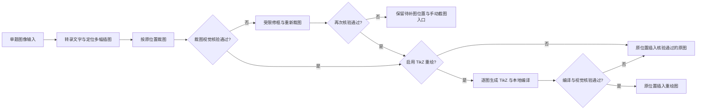

# MathBank - 本地化数学题库与组卷排版工作台

[中文](README.md) | [English](README_EN.md)

📖 **使用帮助**：[MathBank 帮助网页](https://mathbank.pages.dev/)

> **项目标签**：数学题库 | 高中数学 | 备课教研 | A4 仿真排版 | 智能组卷 | 高考级导出 | OCR 识图 | DeepSeek AI | 教育技术

**MathBank** 是一个专为中学数学教师打造的、完全运行在您自己电脑上的轻量级半自动化数学题库与组卷排版工作台。

无需复杂的前端编译即可运行：Windows 10/11 x64 便携包内置 Python 与匹配的 VC++ 运行库，解压后即可启动；macOS 便携包不内置 Python，运行前请确认本机已安装 Python 3.10 或更高版本，启动器会自动检测并创建或修复项目隔离的 `venv`。支持数学公式与几何图形秒级预览，深度集成一键组卷、A4 仿真画布排版、高考级 PDF 试卷导出、DeepSeek AI 解题以及一键 OCR 题目识别。

https://github.com/user-attachments/assets/46834cbd-3499-4c06-9d8e-c81bdc10a0a7





---

## ✨ 核心亮点

只需了解一些基础的 LaTeX 数学公式语法，MathBank 就能帮一线数学老师高效解决组卷与备课难题：

- 🧑‍🏫 **让 AI 备课工作流读取自己的题库（3.0.2 源码）**：新增 Agent 只读取题接口并优化命令行检索。可先发现教材、题型与知识点，再分页找候选，按稳定 ID 读取完整题干、解析、教师评析和配图清单，供有本机访问能力的 AI 工具准备教案、例题与分层作业。读取不修改题库，也不自动生成教学材料或调用模型；采用前仍需核对原题与图片。见 [接入指南](https://github.com/JudgePeach/math-question-bank/blob/main/docs/AI_DATABASE_GUIDE.md) 和下方命令示例。
- 🎨 **1:1 A4 仿真组卷排版**：提供像 Word 一样直观的仿真试卷画布，密封线、大标题、注意事项框一应俱全。支持拖拽排序、题目留白高度调整，以及一键切换 A3 答题卡与高考 19 题预设。
- ⚡ **秒级公式渲染与高考级导出**：内置专业数学公式排版引擎，网页上修改秒级实时预览。题库与草稿中的选择题完整显示题干、选项和图片，选项按实际宽度在四列、两列和单列之间调整；单列长文字自然换行，只有超宽且不可拆分的公式独立横向滚动。小问分段保留前置标点。支持一键导出高考标准的高清 PDF 试卷与完整的排版源码包。
- 🤖 **AI 智能组卷与辅助解答**：按教师要求，从题库已有题目中选择并加入试卷草稿；支持单题一键 AI 生成详细解析与教学反思。
- 🔢 **连续序号与稳定关联**：题目显示序号随库内增删和整理顺序更新，稳定数据库 ID 继续用于试卷与交叉引用。独立排序随完整备份保留；分享包导入后按接收题库的顺序编号。
- 📚 **六套教材大纲切换**：内置 **人教A版**、**人教B版**、**苏教版**、**沪教版**、**北师大版**与**湘教版**目录。各版独立保存题目位置，切回时恢复已有分类，知识点及其标注依据继续共用。首次切换根据已确认主要知识点和真实目录对照定位；有歧义的保留待细分或待定位，便于继续核对。
- 📄 **多格式试卷智能拆解与 PDF 双策略分流**：支持直接拖入 **LaTeX 源码 (.tex)**、**Markdown (.md)**、**PDF 试卷 (.pdf)** 或 **Word 试卷 (.docx)** 快速智能切片拆题。Markdown 支持尚不完善，拆分结果可能有误，请谨慎使用，并在入库前逐题核对题干、公式、配图与答案对应。PDF 拆解原生提供 **【原生文字公式提取】（默认推荐）** 与 **【全图视觉 OCR】** 双解析策略：推荐优先使用原生提取模式，享受 `PDF Inspector` 毫秒级 0 视觉 Token 损耗的极速提取，当遇到 Word/MathType 特殊导出卷导致公式硬转化为图片时，系统会自动平滑降级并触发 VLM 视觉 OCR 识图补全；同时，为避免极少数排版极其特殊的试卷使自愈规则失效，系统亦保留了全图视觉 OCR 备选通道与原页复核提示；模型识别结果仍需对照原卷检查。Word 导入则会结构化转换 Office OMML，并从 OLE `Equation Native` 流解析 MathType 结构，不能高置信转换的公式保留原预览图并标记人工核对。

---

## 🤖 AI Agent / Harness 工作流

系统内置了多套高度自动化、容错与自愈的 AI Agent / Harness 工作流，保障试卷拆解、几何绘图与并发解题的高可靠性：

### 1. PDF 试卷智能解析 (PDF Parsing Harness)


### 2. 单题识图、裁图与可选 TikZ 重绘 (Single-Question OCR Harness)


此流程适用于单题 OCR。PDF、Word 整卷导入使用各自的配图与来源核对流程，仍需对照原卷检查。

### 3. 试卷切片与并发解题管道 (Paper Ingestion Harness)


---

## 📝 使用前提与环境说明

- **LaTeX 本地编译环境依赖**：只有当您需要使用 **TikZ 几何图形重绘** 或 **一键导出高清 PDF 试卷** 这两项功能时，系统才需要调用本地的 LaTeX 编译工具链。如果您仅进行题目录入、公式预览、题库检索、AI 智能解答与排版源码导出，**完全不需要安装 LaTeX**。若需使用上述两项功能，建议您在本地安装：
  * **macOS 用户**：推荐安装 [**MacTeX 官网**](https://www.tug.org/mactex/)（安装包约 5GB，国内推荐使用 [清华大学镜像站](https://mirrors.tuna.tsinghua.edu.cn/CTAN/systems/mac/mactex/) 极速下载）
  * **Windows 用户**：推荐安装 [**TeX Live 官网**](https://www.tug.org/texlive/)（ISO 镜像约 5GB，国内推荐使用 [清华大学镜像站](https://mirrors.tuna.tsinghua.edu.cn/CTAN/systems/texlive/Images/) 极速下载；也可选择 MiKTeX）
- **📄 Word (.docx) 试卷安全导入**：无需安装 Microsoft Word 或 MathType。系统可转换常见 OMML 公式，并使用 `olefile` + MTEF v5 记录树解析 MathType 结构；普通 `32`、拉丁 `p` 等不会再因旧的字符规则被误判。系统还会递归保留超链接/修订文字/Symbol 字符并提取表格与原图，不能高置信转换的公式则保留 Word 预览图。拆卷报告会分别显示结构转换、内嵌 LaTeX、有限兼容及人工核对数量。
- **📝 Word 可编辑公式导出**：系统会优先复用电脑上已安装的 Pandoc。首次导出时如未检测到，经用户确认后自动下载并安装到 MathBank 本地运行目录，安装完成后自动继续原导出；无需管理员权限、手动选路径或配置 PATH。下载优先使用 Pandoc 官方 GitHub Release，失败时自动切换 SourceForge 备用线路，两条线路均使用同一固定 SHA-256 校验。

- **单题 OCR 与多图处理**：题干、选项和表格中的插图分别定位并保留原位置。禁用 TikZ 时仍会裁图和视觉核验；启用时增加重绘、编译与重绘图核验，失败则回退到核验通过的原图。没有可靠裁片时保留待补图位置，可手动截图补入。含图核验会增加模型调用与等待时间，关闭 TikZ 仍保留裁图核验。
- **识图期间的编辑保护**：识别期间若有新增编辑，会保留现有内容，并等待用户明确载入识图结果；切换题目后旧结果不会覆盖新编辑。手动截图定位期间若题目内容变化，旧操作会被拒绝，需重新定位。
- **exam-zh 正体常量预览**：网页支持 `\iu` / `\upi` 显示正体 i，`\eu` / `\upe` 显示正体 e；普通变量 i、e 仍为斜体。兼容处理只作用于网页预览，不改写题目原文、数据库或导出源码。
- **图片保存与教材分类**：教师评析图片随保存、草稿及完整备份保留。教材小节仍为单值，无法唯一确定时显示整章定位，并保留历史和自定义分类。
- **题库搜索（当前源码）**：输入 `#123` 可精确查找界面显示的第 123 题；纯数字仍会同时匹配题号与文字。题库和组卷列表搜索不再匹配正文、解析或评析中的图片地址，仍可搜索图片说明文字。这次修复尚未进入正式下载包。
- **知识点 AI 补充（当前源码）**：分类结果可只应用新增知识点，随后正常保存；已有标注保留，教材位置无法确定时仍可使用可靠知识点。提示逐小问区分主考目标与实际辅助方法，并比较更贴切的具体知识点；仅最终答案不当作解析，辅助点须有实际步骤依据，明确小问缺少主要考点时会提示核对。此次流程优化尚未包含在已发布的 V3.0.1 下载包中。
- **慢推理与大文件等待（当前源码）**：普通AI默认等待15分钟，文档识图/拆卷/来源核验默认30分钟；本地PDF每遍编译、Word转换及原Word渲染各5分钟。可在`.env`通过`MATHBANK_AI_REQUEST_TIMEOUT_SECONDS`和`MATHBANK_DOCUMENT_AI_TIMEOUT_SECONDS`分别设置60–7200秒，重启后生效。超时后的未知远端结果不会自动重发。上述调整尚未包含在正式V3.0.1下载包中。
- **PDF 排版与缺字诊断（当前源码，待发布）**：网页 A4 为模拟排版，请打开“PDF 预览”核对实际编译结果。能容纳在一页内的普通带图题保持题干与配图同页，长题仍可跨页。导出副本适配正文中的 `△`、`∠`，保留已有数学环境与题目原文；发现其他字体缺字会停止导出并提示字符及可定位的题目位置。未配置 API 也可查看本地诊断；其他编译错误可由已配置的试卷智能拆解模型补充建议，不自动改写原题。这些调整尚未包含在正式 V3.0.1 下载包中。
- **导入容错（当前源码，尚未进入正式 V3.0.1 下载包）**：PDF 部分页面识别失败时，先保留能确认完整的题目，缺页及跨页碎片留待补做；当前页面中的显式补做沿用原任务并复用成功页面。批量导入先处理合格题，未导入题及原因保留在题卡工作区。Word 单批核验响应格式异常不再连带停止后续独立批次；服务异常、来源变化及取消仍停止。网络暂断时持续退避查询原任务，不重新上传或自动重发模型请求。知识点可选说明字段错误不再连带丢弃有效建议，编码、主辅角色及原文证据仍须通过校验；已有题目与标注不会自动重写。
- **分类依据与质量档（当前源码，待发布）**：支持常见混合/嵌套小问及逐目标漏标提示，并列产物不会因只引用其中一项就判全部覆盖。图像逐项说明未提供原因；图片原解可在同一次分类请求中提供有绑定的步骤转录，明确标注“未经独立核验”，只有最终答案仍不猜辅助方法。设置中的分类质量默认“快速”，可按需选择“精细”；支持该控制的渠道按档位调整思考与输出预算，可能增加耗时和用量，不自动修改已有题目标注。Word 已可靠提取的正文不会因个别题型/难度或无害说明字段错误而重新整卷抄写；来源身份冲突仍停止。
- **当前题按需精细复核（当前源码，待发布）**：快速分类结果不理想时，可在预览中点击“本题精细复核”，仅用精细档重新分析当前题，默认快速模式保持。该操作可能增加耗时与用量；失败或取消等待保留原快速建议，成功后仍由用户确认应用与保存。题文或分类上下文变化时，旧响应不会覆盖新编辑。此次没有将未通过独立对照的压缩Prompt替换为默认。中转B的`gemini-3.8-flash-high`保持原模型别名，按题复核仅增加输出预算，不另行提高其high档位。
- **AI 组卷选题精读（当前源码，待发布）**：候选初筛保留小问纲要，入围长题和图题按需追加一次同模型精读，整题原文不截断，并说明必要图片是否实际提供。全文超预算、缺图或精读失败时明确使用本地规则结果，不冒充完成精读；题文或图片变化后旧选择失效。原筛选、题型配额和排除已选题仍生效。
- **常用容量配置（当前源码，待发布）**：文件大小、图片像素、PDF页数、文档队列及分类图片容量集中配置于 `.env.example` 所列 `MATHBANK_*` 项，默认容量保持；修改后须重启。`PDF_OCR_CONCURRENCY` 的1–12实际作用于普通PDF请求总门，辅助核验共享总名额；独立解压、渲染和图像证据安全预算继续保留。
- **AI 选题与高考参考（当前源码）**：在组卷工作台展开“AI 选题”，设置1–30题、填写要求，可参考库内近期完整高考卷、选择具体参考卷或关闭参考；需求中明确写出的题数优先。选题遵守当前教材、主辅知识点、题型、难度和关键词筛选，排除卷面已选题，并参考题干、覆盖面和难度梯度。参考风格不要求只选高考真题；来源按库内标注识别，不能视为官方核验。默认按要求与范围匹配随程序保存的课标选摘，在现有选题和按需精读请求中复用，不增加操作或AI调用；选题说明保留条目、页码与题文依据。参考不足、可选题不足或AI不可用时会明确提示并提供本地选题结果；本地补选不宣称已评估课标契合度，仍需教师检查。本次优化尚未进入正式下载包。

---

## 🚀 快速开始

**版本边界（2026-10-26）**：当前源码版本为 **3.0.2**。GitHub 最新正式下载仍为 **V3.0.1**；上文标注“当前源码”或“待发布”的功能尚未包含在该正式包中。源码推送、本地打包和 GitHub 正式 Release 分别管理，下载时请以发布页实际附件为准。

### 📦 方式一：下载便携包（非技术/小白用户首选）

如果您不熟悉命令行或 Python 环境，可以直接前往 [**Releases 页面**](https://github.com/JudgePeach/math-question-bank/releases) 下载官方构建包。发布页同时提供 `.zip.sha256` 校验文件，建议核对后再解压：

* **Windows 用户**：使用 Windows 10/11 x64，下载 `MathBank-Windows-x64.zip`（内含完整 Python 3.10 与应用本地 VC++ 运行时，无需另行安装），解压后双击运行 **`启动题库系统.bat`**
* **macOS 用户**：下载 `MathBank-macOS.zip`。**macOS 包不内置 Python，运行前请确认本机已安装 Python 3.10 或更高版本**。启动器会自动检测可用 Python，并自动创建或修复项目隔离的 `venv`；如未检测到合格版本，将提示安装并停止启动。首次创建或修复环境时需要联网，然后双击 **`启动题库系统.command`**

两个启动器会检查 Python 和依赖是否齐全；题库已在运行时直接打开网页，无需关闭后重新启动。旧 PID/状态文件和 Release 清单不参与启动核验。端口冲突或启动失败时会显示具体原因和服务日志。

---

### 💻 方式二：源码运行

1. **克隆项目**：
   ```bash
   git clone https://github.com/JudgePeach/math-question-bank.git
   cd math-question-bank
   ```

2. **安装依赖**（要求 Python 3.10+）：
   ```bash
   python -m pip install -r requirements.txt
   ```
   参与开发或运行测试时，改用 `python -m pip install -r requirements-dev.txt`。依赖版本已锁定，升级时请同步运行测试与 `python -m pip check`。

3. **启动项目**：
   * **Mac 用户**：双击 **`启动题库系统.command`**
   * **Windows 用户**：双击 **`启动题库系统.bat`**
   * **命令行启动**：运行 `python -m uvicorn main:app --reload`，浏览器访问 `http://127.0.0.1:8000`

> [!TIP]
> **PDF & Word 试卷智能拆解建议**：
> 1. **PDF 策略选型**：导入 PDF 试卷时，建议保持默认选中的**【原生文字公式提取】**模式，享受毫秒级 0 视觉 Token 损耗极速切片；若遇到图片公式导致丢公式系统会自动触发 VLM OCR 补全；遇排版极其特殊的扫描卷可手动切换为**【全图视觉 OCR】**模式。
> 2. **试卷内容建议（避免超出 Token 限制）**：无论导入 **PDF 试卷** 还是 **Word (.docx) 试卷**，为防止试卷过长超出大模型单次 Context Window / Token 窗口上限，强烈建议优先选用**仅含题干（无冗长详细解析）**的试卷进行切片拆分。

---

## 🔑 API 配置与大模型选型指南

无论是使用源码还是便携包，AI 智能解析与 OCR 公式识别均依赖外部 API。启动项目后，点击网页右上角的 **设置（齿轮）按钮** 填入并保存密钥，并分别选择解题、拆卷、分类、识图与绘图任务的供应商和模型。模型名称、图像输入能力、价格与试用活动以对应平台当前说明为准：

### 1. 🤖 文本任务模型（解题/拆卷/分类）
程序提供 [DeepSeek 官方开放平台](https://platform.deepseek.com/) 等供应商接入，可在设置中为各任务选择模型。DeepSeek 预设包含 `deepseek-flash` 与 `deepseek-v4-pro`；程序将 V4 Pro 用于文本任务，带图识图应选择下方的图像输入型号。

### 2. 📷 默认公式识图模型（OCR - 必须使用多模态 VLM 大模型）
* **图像输入要求**：公式识图必须选择能接收图片的具体型号，仅支持文字输入的型号不能用于 OCR。
* **DeepSeek 官方识图**：在设置的“默认公式识图模型”中选择 **DeepSeek → `deepseek-flash`**，复用 DeepSeek API Key。程序的 DeepSeek 官方识图预设为 Flash；`deepseek-v4-pro` 不作为识图型号。
* **其他供应商预设**：程序提供 [硅基流动 (SiliconFlow)](https://cloud.siliconflow.cn/i/hkgjSWrg)、[阿里云百炼](https://bailian.console.aliyun.com/) 等接入。硅基流动的识图预设包含 `Qwen/Qwen3-VL-8B-Instruct`；百炼常规 OCR、拆卷和分类预设为 `qwen3.7-flash`，解答与绘图为 `qwen3.7-plus`。请按平台实际开放的型号选择，注册赠额和试用额度以当时活动规则为准。
* **海外/中转站模型**：可在相应供应商下选择预设或填写自定义模型名称；用于识图时需确认该接口支持图像输入。价格、计费方式及效果可能随平台和任务变化，建议先用少量代表性题目核对结果与用量。

### 3. 🎨 TikZ 几何绘图模型（`PREFER_DRAW_MODEL`）
* 为绘图任务单独选择模型；有参考图片的重绘需要该型号和接口支持图像输入。
* 建议先用少量代表性几何图检查编译结果与原图是否一致。编译成功后仍需核对图形，单题 OCR 的自动核验与回退流程见上方说明。

> [!WARNING]
> **关于第三方 API 中转站的风险与担保声明**
> 
> 下面提供的两个中转站链接**仅因为开发者个人日常在用，不对其服务稳定性、模型真实度（是否存在掺水/以次充好）或数据隐私安全性提供任何形式的担保**。第三方中转站可能存在数据泄露、隐私风险或模型替换行为，请用户务必谨慎评估与使用：
> * **开发者使用的中转站 A**：[RightCodes 注册链接](https://www.rightapi.ai/register?aff=f7656b31)。可用模型、价格及图像输入支持以该平台说明为准。
> * **开发者使用的中转站 B**：[PackyAPI 注册链接](https://www.packyapi.com/register?aff=5yyF)。可用模型、价格及图像输入支持以该平台说明为准。

> [!IMPORTANT]
> **关于 TikZ 自动几何重绘与本地 LaTeX 编译环境依赖**
> 
> 系统的 AI 智能几何插图 TikZ 重绘和 PDF 试卷编译渲染功能，高度依赖您**本地已安装的 LaTeX 编译排版环境**（如 macOS 下的 **MacTeX**，Windows 下的 **TeX Live** 或 **MiKTeX**）。
> 请确保安装后，您本地的命令行中能正常调用 `pdflatex` 与 `xelatex` 命令（即已正确将 LaTeX 工具链加入系统的环境变量 `PATH`）。如果本地未安装，AI 生成的 TikZ 源码和试卷 LaTeX 源码依旧能够完好保存与导出，但后台编译 PDF 将受到限制。

## 🔄 版本升级与数据备份

### 升级方式

- **✨ 界面一键检查更新与便携包直链**：系统内置自动版本检测机制。进入网页右上角【设置】$\rightarrow$【版本更新】，即可一键实时比对 GitHub 官方 Release，查阅最新版本特性并一键下载对应系统的便携包；亦支持一键忽略不常更新的版本。
- **方式 A：Git 升级（源码用户推荐）**
  先创建完整备份并安全关闭题库服务，再更新代码：
  ```bash
  git pull
  ```
  数据库 (`*.db`)、API 密钥 (`.env`)、维度配置 (`data_backup/`) 及插图 (`static/uploads/`) 均由 Git 忽略，不属于正常代码更新内容。更新后启动程序会按需迁移数据库结构；请保留本地数据目录和未提交的编辑，启动后确认页面版本与更新后的程序一致。

- **方式 B：便携包覆盖更新**
  1. 先创建一份可验证完整备份（见下方“完整备份与恢复”）。
  2. 在网页右上角点击电源按钮安全关闭题库，等待页面提示服务已停止；不要在后台运行时覆盖。
  3. 把新版 ZIP **解压到一个临时新目录**，不要直接解压进原目录。
  4. **Windows**：打开新版文件夹，全选其中的“内容”并复制到原项目目录，选择替换所有同名文件。
  5. **macOS Finder**：先按 `Command + Shift + .` 显示 `.env.example` 等隐藏文件，再复制新版文件夹里的全部“内容”到原目录并合并同名目录；**不要选择“替换整个文件夹”**，否则 Finder 可能先删除原目录中的本地数据。
  6. 双击新版启动器，自动准备运行环境并打开题库。启动器不再校验历史 Release 清单或自动删除历史发布文件；如果仍打开旧版本，请在网页电源按钮关闭服务后再启动。

  覆盖升级会保留根目录数据库及 WAL/SHM、`.env`、`data_backup/`、`static/uploads/`、`.system_generated/` 和 `venv/`。请勿删除原项目目录再换成新目录。Windows 10/11 x64 便携包内置完整 Python 与 VC++ 运行时，无需另行安装；macOS 包不内置 Python，运行前请确认本机已安装 Python 3.10 或更高版本。macOS 启动器会自动创建或修复 `venv`，仅在首次建立环境或 `requirements.txt` 变化/依赖缺失时需要联网安装。

### 数据库升级与退回旧版

受支持的正式旧版可直接升级当前版本，无需逐版安装。只有数据库结构需要更新时，程序才会先在 `data_backup/schema_snapshots/` 创建并校验旧数据库副本，再执行迁移；这份自动快照只含数据库。下方的“完整备份”还包含题目引用的图片和自定义元数据，升级前应另行创建并保留。

如需退回旧版，请先安全关闭服务，再恢复升级前的完整备份并使用对应旧版程序。仅替换旧程序文件可能因数据库结构版本较新而无法启动；恢复后数据回到备份时的状态，升级后新增或修改的内容需另行保留。数据库结构编号与软件版本号分别管理，升级不会自动重新分类历史题目。

> [!IMPORTANT]
> **数据备份建议**
> 
> 完整备份是覆盖升级的首选保险。如需额外手动备份，请备份以下重要文件/目录：
> - `*.db` (本地题目数据库)
> - `.env` (API 密钥配置)
> - `data_backup/` (自定义维度与章节大纲配置)
> - `static/uploads/` (已上传的插图与几何图形)

---

## 🛠️ 命令行检索与实用脚本

### 1. 本地终端极速检索 (`scripts/search_questions.py`)
在终端中快速检索题库（如搜索“导数”）：
```bash
python3 -m scripts.search_questions -q "导数"
```
**主要参数**：`-q` 关键词 | `-n` 返回数量 (Markdown 默认 50，`-1` 保留显式全量兼容) | `-a` 携带答案解析 | `-t` 题型过滤 | `-d` 难度过滤 | `-r` 关联题目检索。

Agent 建议先发现当前枚举和知识点，再小页检索、按稳定 ID 取完整题目：
```bash
python3 -m scripts.search_questions --capabilities --format json
python3 -m scripts.search_questions --catalog --knowledge-query "单调性" --format json -n 10
python3 -m scripts.search_questions --knowledge-point 1136 --format json -n 10
```
知识点编码请先从目录结果确认；选定题后，用本次返回的真实 ID 读取完整教学材料及配图清单（下方 `123,456` 仅为语法示例）：
```bash
python3 -m scripts.search_questions --ids 123,456 --profile teaching --format json
python3 -m scripts.search_questions --ids 123,456 --assets --format json
```
查询采用只读快照，不修改题库。JSON 默认候选摘要20题；选中题后可用 `--ids`、`--profile teaching/evidence` 读取完整题干、评析与按需依据，`--assets` 获取图片用途、状态和可读路径。完整说明见 [Agent 只读取题指南](https://github.com/JudgePeach/math-question-bank/blob/main/docs/AI_DATABASE_GUIDE.md)，运行服务后也可使用新增的只读 `/api/agent/` 接口。

### 2. 数据清洗与自愈脚本
- **填空题下划线全量升级**：`python3 -m scripts.migrate_fillin`（将旧下划线规范化为 `\fillin` 宏）
- **选择题题干空括号净化**：`python3 -m scripts.migrate_choice_parentheses`（自动抹除题干末尾空括号，防止与 `\paren` 重叠）
- **构建跨平台 Release（源码仓库专用）**：在源码仓库中先确认 `mathbank/__init__.py` 的版本号，再运行 `python3 -m scripts.build_release`；便携包不包含构建脚本。构建器会校验固定 SHA-256 的官方 Python/NuGet 运行时、Release 白名单、运行时布局与源码 smoke，并生成包内 `RELEASE-MANIFEST.json` 和包外 `.zip.sha256`。

### 3. 完整备份与恢复

```bash
# 创建数据库 + 上传图片 + 自定义元数据的可验证完整备份
python3 -m scripts.backup

# 旧题图片已丢失时：保留数据库与引用，在清单中记录缺图并告警
python3 -m scripts.backup --allow-missing-images

# 只校验备份，不改动当前数据
python3 -m scripts.restore data_backup/snapshots/mathbank-backup-时间戳.zip

# 实际恢复：必须先完全关闭题库服务
python3 -m scripts.restore data_backup/snapshots/mathbank-backup-时间戳.zip --apply --yes
```

完整备份含逐文件 SHA-256 清单，不包含 `.env`、本地 Token 或 API 密钥。服务与恢复工具共用跨平台运行锁，服务未完全关闭时恢复会拒绝执行。`questions_backup.json` 只是兼容检索与同步的 JSON 导出，不能代替完整备份。

### 4. 题库分享与批量导入

在 **设置 → 题库分享** 中，先按来源或关键词查看题目；展开“更多筛选”还可按教材册次、章节、小节及考查知识点定位。考查知识点匹配已确认的主要考查点，可选择包含任意一个或同时包含全部。列表显示题号、已渲染公式的题干摘要和来源，完整题干按需预览；选择界面以配图提示代替图片，分享 ZIP 仍保留完整原图。逐题勾选、全选本页或全选筛选结果后，按钮会显示实际导出题数。“已选”可核对跨页选择，更换筛选不会清空勾选。需要分享全库时，清除筛选后点击“全选筛选结果”即可。

下载的 ZIP 包只包含已选题目，以及解析、评析、分类、知识点、TikZ 和所需配图。交给对方后，切换同一页面顶部的“导入分享包”，选择文件并批量导入，无需重新识别或配置 SQLite。导出前会重新检查勾选题目，已删除的题会明确提示，避免生成残缺分享包。导出在后台打包，完成后直接下载ZIP，也可再次点击“下载分享包”。

导入仅接受本功能生成的 ZIP 分享包，每道题都会分配新 ID，图片自动使用独立文件名，并保留包内题间关联。**不查重、不覆盖已有题目；同一个包重复导入会再次新增。** 系统在校验通过后自动创建完整备份，再一次性写入。后台任务显示校验、备份、写入和指纹处理等阶段；大批题目按有界批次处理、完整指纹在同一次提交前生成，减少内存占用和逐题写入开销；关闭设置或刷新页面后会查询同一次任务，断连时点击“重新连接”，不会自动重复上传。主动再次导入同包须确认再次新增；若服务中断且提交结果无法确认，请先核实题库与备份，再结束旧记录。接收方需要使用支持此分享格式的版本。

导入前备份允许原有题库引用的图片已经不存在：保留题目原文与图片引用，归档其余可读图片，备份清单逐项记录缺图，页面提示数量后继续导入。不会补造图片或修改旧题。手动及每日备份默认仍要求图片完整，手动可用 `--allow-missing-images` 显式容错；实际缺图的备份使用 v3 格式，须由支持该格式的程序验证与恢复，恢复后原缺图仍需补回；图片完整的备份继续使用兼容的 v2 格式。

上传超过512 MiB时会在发送前提示；分享上传的临时文件随程序目录存放。空间不足、目录只读或文件占用会明确提示，备份遇持续数据库占用时会结束等待；这些错误及数据库、归档完整性校验失败仍会阻止导入。

分享包上限为 512 MiB，题目数据上限为 512 MiB，展开后总量上限为 1 GiB；超过限制时请按来源分批导出。分享包只传递题目资源，不包含 API 密钥、系统设置或已保存试卷，也不能代替上方的完整备份。

---

## 📂 项目目录结构

以下是源码仓库的目录示意。便携发布包保留题库运行、启动、备份恢复和检索所需组件，不包含内部批处理工具、`tests/`、`docs/`、测试产物或 `scripts/build_release.py`；构建命令用于源码仓库。

```text
.
├── data_backup/                # 实时备份与 AI 专属只读题库 (已忽略)
│   ├── archive/                # 历史迁移与测试数据库归档
│   ├── snapshots/              # 带清单与哈希校验的完整恢复包
│   ├── schema_snapshots/       # 数据库迁移前独立快照及 SHA-256
│   ├── questions_backup.json   # 题目 JSON 同步导出（非完整恢复包）
│   └── questions_library.md    # AI 专属只读题库（过滤答案，防 AI 泄露）
├── docs/                       # 项目文档与 README 展示图片
│   ├── AI_DATABASE_GUIDE.md    # AI 题库检索使用指南
│   └── images/                 # 产品界面预览图
├── mathbank/                   # 后端业务领域包
│   ├── database.py             # SQLite 数据模型与 Session
│   ├── db_migrations.py        # 版本化、备份优先的 SQLite 迁移
│   ├── backup.py               # 完整备份、验证、恢复与回滚
│   ├── asset_security.py       # 上传验证与本地资产路径安全边界
│   ├── task_manager.py         # 有界异步任务、取消与资源生命周期
│   ├── health.py               # 启动就绪与数据库健康检查
│   ├── paper_helper.py         # LaTeX/PDF 编译、排版与 LRU 缓存
│   ├── sync_helper.py          # JSON 同步导出与 AI 题库清洗
│   ├── paths.py                # 与工作目录无关的项目路径单一来源
│   ├── curriculums.py          # 六套教材预设、明确版本身份与来源目录对照
│   ├── prompts.py              # OCR/解题/拆卷/TikZ/组卷提示构建器
│   ├── ai_providers.py         # AI Provider 与模型参数解析
│   ├── ai_http.py              # AI HTTP 请求与鉴权
│   ├── ai_json.py              # AI 结构化 JSON 容错解析
│   ├── ocr_illustrations.py    # 单题图位占位与裁图处理
│   ├── ocr_figure_review.py    # 实际裁片与 TikZ 预览核验
│   ├── ocr_raster_layout.py    # 有界像素版面证据与图框修正
│   ├── latex_diagnostics.py    # XeLaTeX 错误定位、本地解释与 AI 诊断合并
│   ├── content_locks.py        # Word 公式原位可见锁定、原文恢复与完整性校验
│   ├── omml_helper.py          # Office OMML 结构化公式转换器
│   ├── mtef_helper.py          # MathType OLE/MTEF v5 结构解析与失败诊断
│   ├── docx_helper.py          # Word 文字/表格/图片安全提取与诊断报告
│   ├── pdf_inspector_helper.py # PDF Inspector 原生矢量直提与双轨探测
│   └── resources/curriculums/  # A/B/S/H/N/X 六套共享 JSON 大纲
├── scripts/                    # 运维、迁移、检索与 Release 工具
│   ├── search_questions.py
│   ├── backup.py
│   ├── restore.py
│   ├── migrate_fillin.py
│   ├── migrate_choice_parentheses.py
│   └── build_release.py        # 源码构建器；不进入便携包
├── static/                     # 前端静态资源目录
│   ├── index.html              # 主控制台前端页面 (SPA)
│   ├── css/                    # Tailwind, FontAwesome, KaTeX 离线样式
│   ├── uploads/                # 插图存储目录 (暂未引用图片进入可恢复保留区)
│   └── js/                     # 级联加载前端 JS 模块
│       ├── api.js              # API 交互与 Token 拦截
│       ├── editor.js           # 编辑、KaTeX 预览与 TikZ 编译
│       ├── ocr.js              # OCR 公式识别与交互
│       ├── import.js           # 试题拆解与草稿/题库列表
│       └── paper.js            # 组卷排版工作台 & Live Preview 渲染引擎
├── templates/                  # LaTeX 试卷模板与 exam-zh 宏包库
├── tests/                      # Pytest 自动化测试与 artifacts
├── main.py                     # FastAPI 服务主入口与路由逻辑
├── math_question_bank.db       # 本地 SQLite 主数据库（根目录兼容保留）
├── 启动题库系统.bat            # Windows 一键启动脚本
├── 启动题库系统.command        # macOS 一键启动脚本
├── README.md                   # 中文说明文档
├── README_EN.md                # 英文说明文档
├── requirements.txt            # Python 依赖包清单
├── requirements-dev.txt        # 开发与测试依赖
└── .env.example                # 环境变量配置模板
```

---

## 📄 开源协议

本项目采用 [GNU AGPLv3](LICENSE) 协议开源。

---

## 💬 QQ 用户交流群

欢迎加入 MathBank 用户交流群，群号：`1107557945`。

<p align="center">
  
</p>
