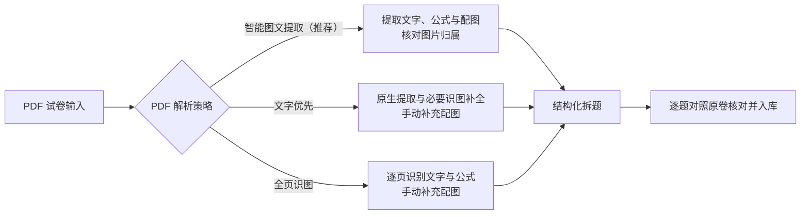
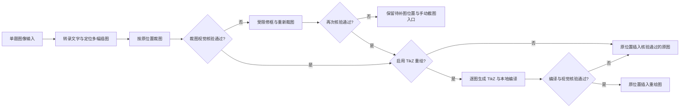

# MathBank - 本地化数学题库与组卷排版工作台

[中文](README.md) | [English](README_EN.md)

📖 **使用帮助**：[MathBank 帮助网页](https://mathbank.pages.dev/)

> **项目标签**：数学题库 | 高中数学 | 备课教研 | A4 仿真排版 | 智能组卷 | 高考级导出 | OCR 识图 | DeepSeek AI | 教育技术

**MathBank** 是一个专为中学数学教师打造的、完全运行在您自己电脑上的轻量级半自动化数学题库与组卷排版工作台。

它支持数学公式与几何图形秒级实时预览，深度集成一键组卷、A4 仿真画布排版、高考级 PDF / Word 试卷导出、AI 辅助解题以及一键 OCR 题目识别。项目无需复杂的前端编译：Windows 10/11 x64 便携包内置 Python 与匹配的 VC++ 运行库，解压即可双击启动；macOS 便携包自动检测本机 Python 3.10+ 并准备独立运行环境。

https://github.com/user-attachments/assets/46834cbd-3499-4c06-9d8e-c81bdc10a0a7


---

## ✨ 核心亮点

只需了解一些基础的 LaTeX 数学公式语法，MathBank 就能帮一线数学老师高效解决组卷与备课难题：

- 🧑‍🏫 **让 AI 备课工作流读取自己的题库**：提供只读 Agent 取题接口与结构化命令行检索。本地 AI 备课工具可先发现教材、题型与知识点目录，分页筛选候选后，按稳定题目 ID 读取完整题干、解析、教师评析和配图清单，用于准备教案、例题与分层作业。读取过程不修改题库，也不自动调用模型；采用前仍需教师核对原题与图片。详见 [接入指南](https://github.com/JudgePeach/math-question-bank/blob/main/docs/AI_DATABASE_GUIDE.md) 及下方命令示例。
- 🎨 **1:1 A4 仿真组卷排版**：提供像 Word 一样直观的仿真试卷画布，密封线、大标题、注意事项框一应俱全。支持拖拽排序、解答题留白高度（0–30 cm）调整，以及一键切换 A3 答题卡与高考 19 题预设。
- ⚡ **秒级公式渲染与高考级导出**：内置专业数学公式排版引擎，网页修改秒级预览。选择题完整显示题干、选项与图片，并按实际宽度在四列、两列、单列间自动适配；长文字自然换行，仅超宽不可拆分的公式独立横向滚动。小问分段保留前置标点，网页预览原生兼容 `\iu` / `\upi`（正体 i）与 `\eu` / `\upe`（正体 e）。支持一键导出高考标准的高清 PDF 试卷、可编辑公式的 Word 文档与完整 LaTeX 源码包。
- 🤖 **AI 智能选题与辅助解答**：在组卷工作台按教材范围、知识点、题型与难度梯度从题库已有题目中挑选题目加入草稿，支持参考库内高考卷风格并自动匹配随程序保存的课标选摘；支持单题一键 AI 生成详细解析与教学反思。
- 🔢 **连续显示题号与稳定 ID 关联**：界面显示的题号随增删和整理顺序自动连续更新；试卷引用、关联题与 Agent 读取接口继续使用稳定的数据库 ID。完整备份保留独立排序，分享包导入后按接收题库的顺序编号。
- 📚 **六套教材大纲与主辅知识点**：内置 **人教A版**、**人教B版**、**苏教版**、**沪教版**、**北师大版**与**湘教版**目录。教材位置与考查知识点（区分主要考查与辅助考查）分开保存：各版教材独立记录题目位置，切换教材时自动恢复已有定位，知识点及其标注依据跨教材共用。
- 📄 **多格式试卷智能拆解**：支持直接拖入 **Word (.docx)**、**PDF (.pdf)**、**LaTeX (.tex)** 或 **Markdown (.md)** 试卷拆题：
  * **PDF 三种解析策略**：默认推荐 **【智能图文提取（推荐）】**（自动提取文字、公式与配图并核对图片归属）；也可选择 **【文字优先】**（优先提取原生文字与公式，必要时识图补全）或 **【全页识图】**（逐页识别文字与公式），后两种策略需手动补充配图。
  * **Word 原生提取**：无需安装 Office 或 MathType，结构化转换 OMML 与 MathType 公式，保留表格与原图；不能高置信转换的公式保留原预览图并提示人工核对。
  * **核对提醒**：Markdown 拆题支持尚在完善；自动提取与模型核验可能增加调用等待，所有导入结果在入库前均需对照原卷检查题干、公式、配图与答案。

---

## 🤖 AI Agent / Harness 工作流

系统内置了多套自动化、容错与自愈的 AI 工作流，保障试卷拆解、几何绘图与并发解题的可靠性：

### 1. PDF 试卷智能解析 (PDF Parsing Harness)


### 2. 单题识图、裁图与可选 TikZ 重绘 (Single-Question OCR Harness)


此流程适用于单题截图 OCR。PDF、Word 整卷导入使用各自的配图提取与来源核对流程，入库前仍需对照原卷检查。

### 3. 试卷切片与并发解题管道 (Paper Ingestion Harness)


---

## 📝 环境准备与导出依赖

- **本地 LaTeX 编译环境（按需安装）**：如果您仅进行题目录入、公式预览、题库检索、AI 解答与 LaTeX 源码包导出，**完全不需要安装 LaTeX**。只有当您需要使用 **TikZ 几何图形编译预览** 或 **一键导出高清 PDF 试卷** 时，系统才需要调用本地的 `xelatex` / `pdflatex` 工具链：
  * **macOS 用户**：推荐安装 [**MacTeX 官网**](https://www.tug.org/mactex/)（安装包约 5GB，国内推荐使用 [清华大学镜像站](https://mirrors.tuna.tsinghua.edu.cn/CTAN/systems/mac/mactex/) 下载）
  * **Windows 用户**：推荐安装 [**TeX Live 官网**](https://www.tug.org/texlive/)（ISO 镜像约 5GB，国内推荐使用 [清华大学镜像站](https://mirrors.tuna.tsinghua.edu.cn/CTAN/systems/texlive/Images/) 下载；也可选择 MiKTeX）
- **📄 Word (.docx) 试卷免依赖导入**：无需安装 Microsoft Word 或 MathType。系统自动转换常见 OMML 公式，并通过 `olefile` + MTEF v5 记录树解析 MathType 结构（普通数字 `32`、拉丁字母 `p` 等不会因旧字符规则被误判），递归保留超链接、修订文字、Symbol 字符、表格与原图。拆卷报告会分别列出结构转换、内嵌 LaTeX、有限兼容及需人工核对的数量。
- **📝 Word 可编辑公式导出（Pandoc 自动准备）**：导出含可编辑公式的 Word 时，优先复用本机已安装的 Pandoc。若首次导出未检测到，经用户确认后会自动从官方 GitHub Release（或 SourceForge 备用线路）下载并安装到 MathBank 本地运行目录，通过固定 SHA-256 校验后自动继续导出，无需管理员权限或手动配置环境变量 `PATH`。

---

## 🔍 导入、分类与组卷细节说明

### 1. 单题识图与试卷导入容错
- **单题多图定位与核验**：单题截图中的题干、选项和表格插图会分别定位并放回原文字位置。关闭 TikZ 时直接裁图并做视觉核验；开启 TikZ 时增加重绘、编译与重绘图核验，失败则自动回退到核验通过的原图，无可靠裁片时保留待补图位置供手动截图。
- **识图期间的编辑保护**：识别过程中若您继续修改了题干，系统会保留当前编辑，待识别完成后由您主动点击「载入识别结果」；切换题目或题目内容变化后，旧的识别响应或手动截图定位不会覆盖新内容。
- **部分失败保留与断点续查**：
  * **PDF 局部保留与补做**：部分页面识别失败时，先保留已确认完整的独立题目，缺页与跨页碎片留待当前页面按提示补做（复用已成功页面，不跨刷新或重启恢复；若选中页全部失败则直接报错）。
  * **批量入库与 Word 核验**：批量导入优先写入合格题，未导入题及原因留在工作区。Word 单批核验格式异常不影响后续独立批次；正文已可靠提取时，个别题型或附加说明出错不会触发整卷重抄（来源 ID 冲突仍停止）。
  * **网络暂断重连**：断网重连后自动持续查询原任务进度，不会重复上传文件或自动重发模型请求。

### 2. 教材分类、知识点与题库检索
- **知识点补充与依据核验**：在 AI 分类结果中可点击「只应用知识点」，保留当前教材位置与题型，已有标注不会被覆盖。系统逐小问区分主考目标与辅助方法（如并列要求多个目标而只引用其一会提示漏标）；辅助知识点须有实际解题步骤支持，仅有最终答案不会凭空猜测解法。若解析为图片，会在同次请求中附带步骤转录并注明“未经独立核验”。
- **分类质量档位与单题精细复核**：设置中的分类质量默认为**「快速」**，可按需切为**「精细」**。在快速模式下若单题分类不理想，可直接点击预览区的 **「本题精细复核」** 仅用精细档重算当前题（失败或取消保留原建议；中转 B 的 `gemini-3.8-flash-high` 保持原模型别名，仅提高输出预算）。
- **精确题号搜索與图片过滤**：搜索框输入 `#123` 可精确查找界面显示的第 123 题；输入纯数字则同时匹配题号与题文。搜索会自动排除题干、解析和教师评析中的图片路径，避免文件名数字造成误命中（图片说明文字仍可搜索）。教师评析中的图片随题目保存、草稿与完整备份一并保留。

### 3. 智能组卷、AI 选题与 PDF 诊断
- **AI 选题、高考参考与课标匹配**：在组卷工作台展开「AI 选题」，可设置 1–30 题并填写考查要求（明确写出的题数优先），支持参考库内近期完整高考卷或指定参考卷风格，并自动匹配随程序保存的课标选摘，在选题说明中保留条目、页码与题文依据。
- **长题与图题按需精读**：初筛保留小问纲要，入围长题与带图题按需追加一次同模型全文精读。若超预算、缺图、精读失败或 AI 不可用，会明确标示使用本地规则补选（不冒充完成精读或课标评估，仍需教师检查）。
- **PDF 同页排版与缺字诊断**：网页 A4 为模拟预览，请点击「PDF 预览」检查实际编译效果。一页可容纳的普通带图题保持题干与配图同页，长题允许跨页。导出副本自动适配正文中的 `△`、`∠`；若遇到其他字体缺字，会停止交付并提示缺失字符及题目位置。未配置 API 也可查看本地编译诊断，其他编译错误可由已配置的拆卷模型补充修复建议（不自动改写原题）。

<details>
<summary>⚙️ <strong>高级配置：处理超时与常用容量限制（点击展开）</strong></summary>

- **慢推理与大文件等待时限**：普通 AI 请求默认等待 15 分钟，文档识图/拆卷/来源核验默认 30 分钟；本地 PDF 每遍编译、Word 转换及原 Word 渲染各允许 5 分钟。可在 `.env` 中通过 `MATHBANK_AI_REQUEST_TIMEOUT_SECONDS` 和 `MATHBANK_DOCUMENT_AI_TIMEOUT_SECONDS` 分别设置为 `60`–`7200` 秒的整数，重启后生效。超时后结果未知的远端请求不会自动重发。
- **常用容量与并发配置**：上传文件大小（默认 PDF 30 MiB / 80 页）、图片像素、文档队列及分类图片容量集中在 `.env.example` 所列的 `MATHBANK_*` 项中配置，修改后重启生效。`PDF_OCR_CONCURRENCY`（`1`–`12`）控制普通 PDF 请求总并发门并与辅助核验共享名额；独立解压、渲染与图像证据安全预算保持不变。
</details>

---

## 🚀 快速开始

**正式版本（2026-10-27 核对）**：当前源码版本为 **3.0.2**，GitHub 已于 **2026年10月26日**正式发布 [**V3.0.2**](https://github.com/JudgePeach/math-question-bank/releases/tag/V3.0.2)，包含上文介绍的 Agent 读取、AI 选题、分类复核及导入与导出改进。双平台便携包以该发布页的实际 ZIP 附件为准；源码提交、本地构建和正式发布分别管理。

### 📦 方式一：下载便携包（推荐一线教师使用）

如果您不熟悉命令行或 Python 环境，请直接前往 [**V3.0.2 发布页面**](https://github.com/JudgePeach/math-question-bank/releases/tag/V3.0.2)，在 Assets 中下载对应系统的 ZIP 附件并**完整解压**：

* **Windows 用户**：使用 Windows 10/11 x64，下载 [`MathBank-Windows-x64.zip`](https://github.com/JudgePeach/math-question-bank/releases/download/V3.0.2/MathBank-Windows-x64.zip)（内置完整 Python 3.10 与应用本地 VC++ 运行时，无需另行安装），完整解压后双击 **`启动题库系统.bat`**。
* **macOS 用户**：下载 [`MathBank-macOS.zip`](https://github.com/JudgePeach/math-question-bank/releases/download/V3.0.2/MathBank-macOS.zip)。**macOS 包不内置 Python，运行前请先确认本机已安装 Python 3.10 或更高版本**。首次准备或修复项目隔离环境 `venv` 时需保持联网，随后双击 **`启动题库系统.command`**。

两个启动器会自动检查 Python 与依赖；若题库服务已在运行，会直接打开网页，无需先关闭再重开。端口冲突或启动失败时会直接显示具体原因与服务日志。

---

### 💻 方式二：源码运行

1. **克隆项目**：
   ```bash
   git clone https://github.com/JudgePeach/math-question-bank.git
   cd math-question-bank
   ```

2. **安装依赖**（要求 Python 3.10+）：
   ```bash
   python -m pip install -r requirements.txt
   ```
   参与开发或运行测试时，改用 `python -m pip install -r requirements-dev.txt`。依赖版本已锁定，升级时请同步运行测试与 `python -m pip check`。

3. **启动项目**：
   * **Mac 用户**：双击 **`启动题库系统.command`**
   * **Windows 用户**：双击 **`启动题库系统.bat`**
   * **命令行启动**：运行 `python -m uvicorn main:app --reload`，浏览器访问 `http://127.0.0.1:8000`

> [!TIP]
> **PDF & Word 试卷智能拆解建议**：
> 1. **PDF 策略选型**：含图试卷优先保持默认的**【智能图文提取（推荐）】**，首次先试 1–3 页包含完整题目的页面，并核对配图归属、裁剪与跨页内容。**【文字优先】**和**【全页识图】**仍可选择，但需手动补充配图；模型识别与自动核验均不能替代原卷检查。
> 2. **试卷内容建议（避免超出 Token 限制）**：无论导入 **PDF 试卷** 还是 **Word (.docx) 试卷**，为防止长卷超出大模型单次上下文窗口上限，强烈建议优先选用**仅含题干（无冗长详细解析）**的试卷进行分批拆分。

---

## 🔑 API 配置与大模型选型指南

无论是使用源码还是便携包，AI 智能解析与 OCR 公式识别均依赖外部 API。启动项目后，点击网页右上角的 **设置（齿轮）按钮** 填入并保存密钥，并分别选择解题、拆卷、分类、识图与绘图任务的供应商和模型。模型名称、图像输入能力、价格与试用活动以对应平台当前说明为准：

### 1. 🤖 文本任务模型（解题/拆卷/分类）
程序提供 [DeepSeek 官方开放平台](https://platform.deepseek.com/)、[硅基流动 (SiliconFlow)](https://cloud.siliconflow.cn/i/hkgjSWrg)、[阿里云百炼](https://bailian.console.aliyun.com/) 等供应商接入。DeepSeek 官方预设包含 `deepseek-flash` 与 `deepseek-v4-pro`（V4 Pro 用于文本解题任务，带图识图请选下方的视觉型号）。

### 2. 📷 默认公式识图模型（OCR - 必须支持图像输入）
* **图像输入要求**：公式识图必须选择支持视觉输入的多模态（VLM）模型，纯文本模型无法进行图片识别。
* **DeepSeek 官方识图**：在“默认公式识图模型”中选择 **DeepSeek → `deepseek-flash`**，可直接复用 DeepSeek 官方 API Key（`deepseek-v4-pro` 不作为识图预设）。
* **硅基流动与阿里云百炼**：硅基流动内置 `Qwen/Qwen3.8-27B`、`deepseek-ai/DeepSeek-V4.1-Flash` 及 `Qwen/Qwen3-VL-8B-Instruct` 等识图预设；百炼常规 OCR、拆卷和分类预设为 `qwen3.7-flash`，解答与绘图为 `qwen3.7-plus`。请按平台实际开放的型号选择，计费与赠额以平台实时规则为准。
* **海外/中转站模型**：可在相应供应商下选择预设或填写自定义模型 ID；用于识图时请确认该接口支持图片输入，并先用少量代表性题目测试效果与用量。

### 3. 🎨 TikZ 几何绘图模型（`PREFER_DRAW_MODEL`）
* 为几何绘图任务单独选择模型；带参考图片重绘时，所选型号与接口同样需要支持图像输入。
* 建议先用少量代表性几何图检查编译结果与原图是否一致。单题 OCR 开启 TikZ 后具备自动视觉核验与原图回退保护，详见上方工作流说明。

> [!WARNING]
> **关于第三方 API 中转站的风险与担保声明**
> 
> 下面提供的两个中转站链接**仅因为开发者个人日常在用，不对其服务稳定性、模型真实度（是否存在掺水/以次充好）或数据隐私安全性提供任何形式的担保**。第三方中转站可能存在数据泄露、隐私风险或模型替换行为，请用户务必谨慎评估与使用：
> * **开发者使用的中转站 A**：[RightCodes 注册链接](https://www.rightapi.ai/register?aff=f7656b31)。可用模型、价格及图像输入支持以该平台说明为准。
> * **开发者使用的中转站 B**：[PackyAPI 注册链接](https://www.packyapi.com/register?aff=5yyF)。可用模型、价格及图像输入支持以该平台说明为准。

> [!IMPORTANT]
> **关于 TikZ 自动几何重绘与本地 LaTeX 编译环境依赖**
> 
> 系统的 AI 智能几何插图 TikZ 重绘和 PDF 试卷编译渲染功能，依赖您**本地已安装的 LaTeX 编译排版环境**（如 macOS 下的 **MacTeX**，Windows 下的 **TeX Live** 或 **MiKTeX**）。
> 请确保安装后，本地命令行能正常调用 `pdflatex` 与 `xelatex` 命令（即已加入系统环境变量 `PATH`）。如果本地未安装，AI 生成的 TikZ 源码和试卷 LaTeX 源码依旧能够完好保存与导出，仅后台编译 PDF 受限。

---

## 🔄 版本升级与数据备份

### 升级方式

- **✨ 界面一键检查更新与便携包直链**：进入网页右上角【设置】$\rightarrow$【版本更新】，即可一键比对 GitHub 官方 Release，查阅新版本特性并直接下载对应系统的便携包；也支持忽略暂不更新的版本。
- **方式 A：Git 升级（源码用户推荐）**
  先创建完整备份并安全关闭题库服务，再更新代码：
  ```bash
  git pull
  ```
  数据库 (`*.db`)、API 密钥 (`.env`)、自定义配置 (`data_backup/`) 及插图 (`static/uploads/`) 均由 Git 忽略。更新后启动程序会按需自动迁移数据库结构；启动后请确认页面版本与更新后的程序一致。

- **方式 B：便携包覆盖更新**
  1. **创建完整备份**：先按下方说明留存一份可验证的完整备份。
  2. **安全关闭服务**：点击网页右上角的电源按钮安全关闭题库，等待页面提示服务已停止；切勿在后台运行时覆盖文件。
  3. **解压到临时目录**：把新版 ZIP **解压到一个新建的临时目录**，不要直接解压进原目录。
  4. **Windows 覆盖**：打开新版文件夹，全选其中的“内容”复制到原项目目录，选择替换同名文件。
  5. **macOS Finder 合并**：先按 `Command + Shift + .` 显示 `.env.example` 等隐藏文件，再复制新版文件夹里的全部“内容”到原目录并选择**合并**同名目录；**切勿选择“替换整个文件夹”**，否则 Finder 可能删空原目录中的本地数据。
  6. **重新启动**：双击新版启动器，自动准备运行环境并打开题库。若仍显示旧版本，请先通过网页电源按钮关闭旧服务后再启动。

  覆盖升级会自动保留根目录数据库及 WAL/SHM、`.env`、`data_backup/`、`static/uploads/`、`.system_generated/` 和 `venv/`。请勿直接删除原项目目录。

### 数据库升级与退回旧版

受支持的正式旧版可直接跨版本升级，无需逐版安装。只有数据库结构需要更新时，程序才会先在 `data_backup/schema_snapshots/` 自动创建并校验旧数据库快照，再执行迁移；**该自动快照仅含数据库文件**，升级前仍应另行创建包含配图与自定义元数据的“完整备份”。

如需退回旧版，请先安全关闭服务，再恢复升级前的完整备份并使用对应旧版程序（不能仅替换旧程序文件，否则较新的数据库结构可能无法被旧版打开）。恢复后数据将回到备份时的状态，升级后新增或修改的题目请提前另存。升级过程不会自动重新分类历史题目。

> [!IMPORTANT]
> **数据备份建议**
> 
> 完整备份是覆盖升级的首选保险。如需额外手动拷贝保留，请备份以下重要文件/目录：
> - `*.db` (本地题目数据库及旁置 WAL/SHM)
> - `.env` (API 密钥配置)
> - `data_backup/` (备份归档、自定义维度与章节大纲配置)
> - `static/uploads/` (已上传的插图与几何图形)

---

## 🛠️ 命令行检索、备份与题库分享

### 1. 本地终端检索与 Agent 只读接入 (`scripts/search_questions.py`)
在终端中快速检索题库（如搜索“导数”）：
```bash
python3 -m scripts.search_questions -q "导数"
```
**常用参数**：`-q` 关键词 | `-n` 返回数量 (Markdown 默认 50，`-1` 显式全量兼容) | `-a` 携带答案解析 | `-t` 题型过滤 | `-d` 难度过滤 | `-r` 关联题目检索。

**AI Agent 取题流程**：建议先发现当前目录与知识点编码，再小页检索候选，最后按稳定 ID 读取完整题目与图片清单：
```bash
python3 -m scripts.search_questions --capabilities --format json
python3 -m scripts.search_questions --catalog --knowledge-query "单调性" --format json -n 10
python3 -m scripts.search_questions --knowledge-point 1136 --format json -n 10
```
确认知识点编码并选定题目后，使用实际返回的稳定 ID 读取完整教学材料及配图清单（下方 `123,456` 仅为语法示例）：
```bash
python3 -m scripts.search_questions --ids 123,456 --profile teaching --format json
python3 -m scripts.search_questions --ids 123,456 --assets --format json
```
查询全程采用只读快照，不修改题库。JSON 搜索默认返回 20 条候选摘要；`--profile teaching/evidence` 可读取完整题干、评析与按需依据，`--assets` 返回图片用途、状态和可读路径。完整说明见 [Agent 只读取题指南](https://github.com/JudgePeach/math-question-bank/blob/main/docs/AI_DATABASE_GUIDE.md)，服务运行时也可调用只读 `/api/agent/` HTTP 接口。

### 2. 数据清洗与构建脚本
- **填空题下划线全量升级**：`python3 -m scripts.migrate_fillin`（将旧下划线规范化为 `\fillin` 宏）
- **选择题题干空括号净化**：`python3 -m scripts.migrate_choice_parentheses`（自动抹除题干末尾空括号，防止与 `\paren` 重叠）
- **构建跨平台 Release（源码仓库专用）**：在源码仓库中确认 `mathbank/__init__.py` 的版本号后，运行 `python3 -m scripts.build_release`（便携包不含此脚本）。构建器会校验固定 SHA-256 的官方运行时、Release 白名单、运行时布局与源码 smoke，并生成包内 `RELEASE-MANIFEST.json` 和包外 `.zip.sha256`。

### 3. 完整备份与恢复

```bash
# 创建数据库 + 上传图片 + 自定义元数据的可验证完整备份
python3 -m scripts.backup

# 旧题图片已丢失时：保留数据库与引用，在清单中记录缺图并告警
python3 -m scripts.backup --allow-missing-images

# 只校验备份完整性，不改动当前数据
python3 -m scripts.restore data_backup/snapshots/mathbank-backup-时间戳.zip

# 实际恢复（替换当前数据）：必须先完全关闭题库服务
python3 -m scripts.restore data_backup/snapshots/mathbank-backup-时间戳.zip --apply --yes
```

完整备份附带逐文件 SHA-256 清单，不包含 `.env`、本地 Token 或 API 密钥。服务与恢复工具共用跨平台运行锁，服务未完全关闭时恢复会拒绝执行。`questions_backup.json` 仅用于兼容检索与同步，不能代替完整备份。

### 4. 题库分享与批量导入

在 **设置 → 题库分享** 中，可将选定题目打包为 ZIP 分享给同事，或批量导入他人分享的题目，无需重新识别或手动配置 SQLite：

- **筛选与导出**：支持按来源、关键词、教材册次/章节/小节及主要考查知识点（包含任意一个或同时包含全部）筛选。勾选题目、全选本页或全选筛选结果后（跨页更换筛选不会清空已选项），后台会打包所选题目的题干、解析、评析、分类、知识点、TikZ 与原图。导出前会自动核查是否含已删除题目，完成后直接下载 ZIP。
- **追加导入与安全备份**：切换到「导入分享包」选择本功能生成的 ZIP 即可批量导入。**导入按新增处理，每题分配新 ID、同名图片安全改名，并保留包内题间关联；不查重、不覆盖已有题目，重复导入同一包会再次新增。**
- **后台进度与断线重连**：校验通过后系统会先自动创建完整备份，再按有界批次写入并一次性提交。关闭设置或刷新页面后会继续查询同一任务，断连时点击「重新连接」即可，不会自动重复上传。
- **旧题缺图容错**：分享导入前的自动备份若发现本地旧题引用的图片已丢失，会保留旧题原文与图片引用、在备份清单中记录缺图并提示数量后继续导入（不会补造图片或修改旧题；权限、空间或数据库校验失败仍会阻止导入）。含缺图记录的备份使用 v3 格式，需由支持该格式的程序恢复。
- **容量与边界**：分享包与题目数据上限均为 512 MiB，展开后总量上限为 1 GiB（超大题库请按来源分批导出）。分享包不包含 API 密钥、系统设置或已保存试卷，也不能代替上方的完整备份。

---

## 📂 项目目录结构

以下是源码仓库的目录示意。便携发布包保留题库运行、启动、备份恢复和检索所需组件，不包含内部批处理工具、`tests/`、`docs/`、测试产物或 `scripts/build_release.py`；构建命令仅用于源码仓库。

```text
.
├── data_backup/                # 实时备份与 AI 专属只读题库 (已忽略)
│   ├── archive/                # 历史迁移与测试数据库归档
│   ├── snapshots/              # 带清单与哈希校验的完整恢复包
│   ├── schema_snapshots/       # 数据库迁移前独立快照及 SHA-256
│   ├── questions_backup.json   # 题目 JSON 同步导出（非完整恢复包）
│   └── questions_library.md    # AI 专属只读题库（过滤答案，防 AI 泄露）
├── docs/                       # 项目文档与 README 展示图片
│   ├── AI_DATABASE_GUIDE.md    # AI 题库检索使用指南
│   └── images/                 # 产品界面预览图
├── mathbank/                   # 后端业务领域包
│   ├── database.py             # SQLite 数据模型与 Session
│   ├── db_migrations.py        # 版本化、备份优先的 SQLite 迁移
│   ├── backup.py               # 完整备份、验证、恢复与回滚
│   ├── asset_security.py       # 上传验证与本地资产路径安全边界
│   ├── task_manager.py         # 有界异步任务、取消与资源生命周期
│   ├── health.py               # 启动就绪与数据库健康检查
│   ├── paper_helper.py         # LaTeX/PDF 编译、排版与 LRU 缓存
│   ├── sync_helper.py          # JSON 同步导出与 AI 题库清洗
│   ├── paths.py                # 与工作目录无关的项目路径单一来源
│   ├── curriculums.py          # 六套教材预设、明确版本身份与来源目录对照
│   ├── prompts.py              # OCR/解题/拆卷/TikZ/组卷提示构建器
│   ├── ai_providers.py         # AI Provider 与模型参数解析
│   ├── ai_http.py              # AI HTTP 请求与鉴权
│   ├── ai_json.py              # AI 结构化 JSON 容错解析
│   ├── ocr_illustrations.py    # 单题图位占位与裁图处理
│   ├── ocr_figure_review.py    # 实际裁片与 TikZ 预览核验
│   ├── ocr_raster_layout.py    # 有界像素版面证据与图框修正
│   ├── latex_diagnostics.py    # XeLaTeX 错误定位、本地解释与 AI 诊断合并
│   ├── content_locks.py        # Word 公式原位可见锁定、原文恢复与完整性校验
│   ├── omml_helper.py          # Office OMML 结构化公式转换器
│   ├── mtef_helper.py          # MathType OLE/MTEF v5 结构解析与失败诊断
│   ├── docx_helper.py          # Word 文字/表格/图片安全提取与诊断报告
│   ├── pdf_inspector_helper.py # PDF Inspector 原生矢量直提与双轨探测
│   └── resources/curriculums/  # A/B/S/H/N/X 六套共享 JSON 大纲
├── scripts/                    # 运维、迁移、检索与 Release 工具
│   ├── search_questions.py
│   ├── backup.py
│   ├── restore.py
│   ├── migrate_fillin.py
│   ├── migrate_choice_parentheses.py
│   └── build_release.py        # 源码构建器；不进入便携包
├── static/                     # 前端静态资源目录
│   ├── index.html              # 主控制台前端页面 (SPA)
│   ├── css/                    # Tailwind, FontAwesome, KaTeX 离线样式
│   ├── uploads/                # 插图存储目录 (暂未引用图片进入可恢复保留区)
│   └── js/                     # 级联加载前端 JS 模块
│       ├── api.js              # API 交互与 Token 拦截
│       ├── editor.js           # 编辑、KaTeX 预览与 TikZ 编译
│       ├── ocr.js              # OCR 公式识别与交互
│       ├── import.js           # 试题拆解与草稿/题库列表
│       └── paper.js            # 组卷排版工作台 & Live Preview 渲染引擎
├── templates/                  # LaTeX 试卷模板与 exam-zh 宏包库
├── tests/                      # Pytest 自动化测试与 artifacts
├── main.py                     # FastAPI 服务主入口与路由逻辑
├── math_question_bank.db       # 本地 SQLite 主数据库（根目录兼容保留）
├── 启动题库系统.bat            # Windows 一键启动脚本
├── 启动题库系统.command        # macOS 一键启动脚本
├── README.md                   # 中文说明文档
├── README_EN.md                # 英文说明文档
├── requirements.txt            # Python 依赖包清单
├── requirements-dev.txt        # 开发与测试依赖
└── .env.example                # 环境变量配置模板
```

---

## 📄 开源协议

本项目采用 [GNU AGPLv3](LICENSE) 协议开源。

---

## 💬 QQ 用户交流群

欢迎加入 MathBank 用户交流群，群号：`1107557945`。

<p align="center">
  
</p>
