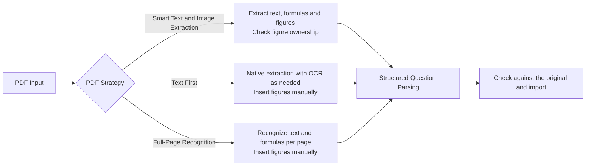
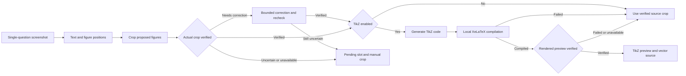
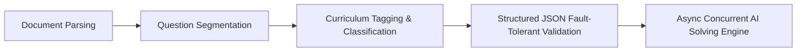

# MathBank - Localized Math Question Bank & Exam Layout Workbench

[中文](README.md) | [English](README_EN.md)

📖 **User Guide**: [MathBank Help Site](https://mathbank.pages.dev/)

> **Project Tags**: Math Question Bank | High School Math | Lesson Prep & Teaching Research | A4 Layout Simulation | Intelligent Exam Generation | Gaokao-Level Export | Formula OCR | DeepSeek AI | EdTech

**MathBank** is a lightweight, semi-automated math question bank and exam paper layout workbench running entirely on your local computer, tailored specifically for secondary school mathematics teachers.

It provides second-level real-time previews of LaTeX formulas and geometric figures, deeply integrated with one-click exam paper creation, A4 simulation canvas layout, Gaokao-level PDF / Word exam export, AI problem solving, and one-click formula OCR recognition. No frontend build step is required: the Windows 10/11 x64 portable package bundles Python and its matching app-local VC++ Runtime so it runs right after extraction; the macOS package automatically detects Python 3.10+ on your Mac and prepares an isolated `venv`.


---

## ✨ Key Highlights

With just basic LaTeX math formula syntax, MathBank empowers frontline math teachers to efficiently solve exam generation and lesson preparation challenges:

- 🧑‍🏫 **Connect your bank to AI lesson-preparation workflows**: Read-only Agent endpoints and a structured search CLI let a locally connected AI tool discover curricula, question types, and knowledge points, page through candidates, and retrieve complete questions, solutions, teacher reviews, and image manifests by stable ID. Reading does not modify the bank, generate lesson materials, or invoke a model; check the original questions and images before teaching. See the [integration guide](https://github.com/JudgePeach/math-question-bank/blob/main/docs/AI_DATABASE_GUIDE.md) and CLI examples below.
- 🎨 **1:1 A4 Simulation Exam Layout**: Provides an intuitive exam paper canvas just like Word, complete with sealing line, title, and notice box. Supports drag-and-drop sorting, solution blank-space adjustment (0–30 cm), and one-click switching to an A3 answer sheet or the Gaokao 19-question preset.
- ⚡ **Second-Level Formula Rendering & Exam-Level Export**: Built-in professional math formula typesetting engine with real-time web preview. Choice options adapt to 4, 2, or 1 columns according to their rendered widths; long text wraps naturally while only indivisible wide formulas scroll horizontally. Sub-questions preserve leading punctuation, and web previews natively support `\iu` / `\upi` (upright i) and `\eu` / `\upe` (upright e). Supports one-click export of high-definition PDFs, editable-formula Word documents, and complete LaTeX source packages.
- 🤖 **AI Exam Selection & Solving Assistance**: Selects existing questions from your bank according to scope, knowledge points, question types, and difficulty progression, with optional style references from complete Gaokao papers in your bank and automatic matching of bundled curriculum-standard excerpts. Single-question AI tools can also generate detailed solutions and teaching reflections.
- 🔢 **Continuous Display Numbers & Stable IDs**: Displayed question numbers update continuously as questions are added, deleted, or reordered, while stable database IDs continue to identify questions in papers, cross-references, and Agent reads. Full backups preserve the independent order; imported sharing packages receive numbers according to the receiving bank's order.
- 📚 **Six Curriculum Outlines & Primary/Supporting Knowledge Points**: Includes **PEP A (人教A版)**, **PEP B (人教B版)**, **Jiangsu (苏教版)**, **Shanghai (沪教版)**, **Beijing Normal University (北师大版)**, and **Hunan (湘教版)**. Textbook placement and examined knowledge points (distinguishing primary targets from supporting methods) are stored separately: each curriculum keeps its own placement and restores it when selected again, while knowledge points and their evidence remain shared across editions.
- 📄 **Multi-Format Exam Parsing**: Drag and drop **Word (.docx)**, **PDF (.pdf)**, **LaTeX (.tex)**, or **Markdown (.md)** files to split questions:
  * **Three PDF Strategies**: The default **Smart Text & Image Extraction (智能图文提取（推荐）)** extracts text, formulas, and figures and checks figure ownership. **Text First (文字优先)** prioritizes native text and formulas with OCR when needed, while **Full-Page Recognition (全页识图)** recognizes pages via VLM; the latter two require manual figure insertion.
  * **Dependency-Free Word Import**: Structurally converts Office OMML and parses MathType structures from OLE `Equation Native` streams without requiring Office or MathType, keeping preview images for formulas that need manual review.
  * **Review Notice**: Markdown support remains experimental; automatic extraction and model review can add waiting time, so always check stems, formulas, figures, and answers against the original before importing.

---

## 🤖 AI Agent / Harness Workflows

MathBank features multiple automated, fault-tolerant, and self-healing AI workflows to ensure high reliability across exam parsing, geometry redrawing, and concurrent solving:

### 1. PDF Parsing Harness


### 2. Single-Question OCR, Reviewed Crops & Optional TikZ

This flow applies to single-question screenshots. PDF and Word batch imports use their own extraction and review workflows.



### 3. Paper Ingestion & Concurrent Solving Harness


---

## 📝 Prerequisites & Export Dependencies

- **Local LaTeX Environment (Optional)**: If you only perform question entry, formula preview, searching, AI solving, and LaTeX source package export, **no LaTeX installation is required**. A local `xelatex` / `pdflatex` toolchain is required ONLY if you need **TikZ geometry diagram compilation** or **one-click HD PDF export**:
  * **macOS users**: Recommend installing [**MacTeX Official Website**](https://www.tug.org/mactex/) (~5GB; Tsinghua University mirror recommended in China).
  * **Windows users**: Recommend installing [**TeX Live Official Website**](https://www.tug.org/texlive/) (~5GB ISO; Tsinghua University mirror recommended; MiKTeX is also supported).
- **📄 Dependency-Free Word (.docx) Import**: No Microsoft Word or MathType installation is needed. The system converts standard OMML formulas and uses `olefile` + MTEF v5 record trees to parse MathType structures (numbers like `32` and Latin letters like `p` are not misidentified by legacy character rules), while recursively preserving hyperlinks, tracked revisions, Symbol characters, tables, and original images. The parser report details counts for structural conversion, embedded LaTeX, limited compatibility, and manual review needed.
- **📝 Editable Word Formula Export (Automatic Pandoc Setup)**: Word export reuses an existing system Pandoc when available. If none is detected on first export, after user confirmation MathBank automatically downloads and installs Pandoc from the official GitHub Release (with a SourceForge fallback) into its local runtime directory, verifies the pinned SHA-256 digest, and continues the export without requiring administrator privileges or manual `PATH` changes.

---

## 🔍 Import, Classification & Paper Building Details

### 1. Single-Question OCR & Import Resilience
- **Reviewed Diagrams at Original Positions**: Single-question OCR locates multiple diagrams across the stem, choices, and table cells. With TikZ disabled, verified source crops stay at their original positions without needing local LaTeX; with TikZ enabled, failed compilation or preview verification falls back to a verified source crop, or leaves a pending slot for manual cropping.
- **Edit Protection During Recognition**: If you edit a question while OCR is running, your current text is kept and the OCR result waits for you to click **Load recognition result (载入识别结果)**. Late replies or manual crops from an outdated question state are rejected.
- **Partial-Failure Retention & Reconnection**:
  * **PDF Partial Results**: When some PDF pages fail recognition, independently complete questions are retained while missing pages and cross-page fragments await explicit completion in the current page (reusing successful pages, not persisted across refreshes or restarts; if all selected pages fail, an error is reported directly).
  * **Batch Import & Word Review**: Batch import saves eligible questions first and keeps the remaining cards with per-question reasons. A malformed Word review batch does not stop later independent batches; verified Word bodies are not regenerated from scratch due to minor metadata errors (source-ID conflicts still stop processing).
  * **Network Reconnection**: Temporary disconnects trigger backoff polling of the original task without re-uploading files or resending model requests.

### 2. Curriculum Classification, Knowledge Points & Search
- **Knowledge-Point Additions & Evidence Checks**: In AI classification results, you can click **Apply knowledge points only (只应用知识点)** to keep the current textbook placement and question type while preserving existing labels. The prompt checks each sub-question (flagging partial coverage when multiple targets are requested), requires actual solution steps for supporting points rather than a final answer alone, and marks step transcriptions from solution images as not independently verified.
- **Classification Quality Profiles & Single-Question Precise Review**: Classification quality defaults to **Quick (快速)** and can be switched to **Precise (精细)** in Settings. During a Quick preview, click **本题精细复核** to re-analyze only the current question with the Precise profile (failed or cancelled waits keep the Quick suggestions; for relay B's `gemini-3.8-flash-high`, the model alias is preserved and only the output budget is increased).
- **Exact Question-Number Search & Image Path Filtering**: Enter `#123` to find displayed question 123 exactly; plain numbers match both displayed numbers and text. Searches exclude image file paths in stems, solutions, and teacher reviews while keeping image descriptions searchable. Teacher-review images are preserved across saves, drafts, and full backups.

### 3. AI Paper Selection & PDF Diagnostics
- **AI Selection with Gaokao References & Curriculum Standards**: In **AI 选题** (1–30 questions; explicit counts in your prompt take priority), selection respects your current filters, excludes questions already in the draft, optionally references recent complete Gaokao papers in your bank for style and difficulty progression, and automatically attaches matched excerpts from the bundled curriculum standards with clause and page citations.
- **On-Demand Full Reading for Finalists**: Initial screening retains sub-question outlines, and long or illustrated finalists can receive one additional full-stem read with the same model. Missing images, budget overflow, or unavailable AI fall back to clearly labeled local selection rules for teacher review.
- **PDF Same-Page Layout & Missing-Glyph Diagnostics**: The web A4 view is a simulation; open **PDF 预览** to inspect the compiled PDF. Ordinary illustrated questions that fit on a single page keep the stem and figures together, while long questions may span pages. The export copy adapts prose `△` and `∠`; other missing font glyphs stop delivery and report the character and question location. Local diagnostics work without an API key, and the configured paper-parsing model can add suggestions for other compilation errors without rewriting stored questions.

<details>
<summary>⚙️ <strong>Advanced Settings: Processing Timeouts & Common Capacities (Click to expand)</strong></summary>

- **Longer Processing Waits**: General AI requests default to 15 minutes; document OCR, splitting, and source review default to 30 minutes; local PDF compilation per pass, Word conversion, and native Word rendering allow 5 minutes each. You can set `MATHBANK_AI_REQUEST_TIMEOUT_SECONDS` and `MATHBANK_DOCUMENT_AI_TIMEOUT_SECONDS` in `.env` (`60`–`7200` seconds) and restart. Timed-out requests with unknown remote state are not automatically resent.
- **Configurable Capacities**: File sizes (default PDF 30 MiB / 80 pages), image pixels, document queue, and classification image limits are configured via the bounded `MATHBANK_*` settings in `.env.example` (restart required). `PDF_OCR_CONCURRENCY` (`1`–`12`) controls the ordinary PDF concurrency gate shared with auxiliary review, while independent archive, rendering, and evidence safeguards remain in place.
</details>

---

## 🚀 Quick Start

**Official release (verified 2026-10-27)**: The current source version is **3.0.2**. [**V3.0.2**](https://github.com/JudgePeach/math-question-bank/releases/tag/V3.0.2) was officially released on **October 26, 2026**, including the Agent reading, AI selection, classification review, import, and export improvements described above. Download the actual ZIP assets for your platform from that release. Source commits, local builds, and official releases remain separate steps.

### 📦 Option 1: Download Portable Package (Recommended for Teachers)

If you are unfamiliar with command line or Python environments, open the [**V3.0.2 release page**](https://github.com/JudgePeach/math-question-bank/releases/tag/V3.0.2), choose the ZIP asset for your platform under Assets, and **extract the complete archive**:

* **Windows Users**: Use Windows 10/11 x64 and download [`MathBank-Windows-x64.zip`](https://github.com/JudgePeach/math-question-bank/releases/download/V3.0.2/MathBank-Windows-x64.zip) (includes complete Python 3.10 and app-local VC++ runtimes; no separate installation required), extract it, and double-click **`启动题库系统.bat`**.
* **macOS Users**: Download [`MathBank-macOS.zip`](https://github.com/JudgePeach/math-question-bank/releases/download/V3.0.2/MathBank-macOS.zip). **The macOS package does not include Python, so confirm that Python 3.10 or newer is installed on your Mac before launching MathBank.** Keep network access enabled when the launcher first creates or repairs the isolated `venv`, then double-click **`启动题库系统.command`**.

Both launchers check Python and required packages, and open an already-running MathBank service directly without restarting it. Port conflicts and startup failures display the specific error and service log.

---

### 💻 Option 2: Run from Source

1. **Clone Repository**:
   ```bash
   git clone https://github.com/JudgePeach/math-question-bank.git
   cd math-question-bank
   ```

2. **Install Dependencies** (Python 3.10+ required):
   ```bash
   python -m pip install -r requirements.txt
   ```
   For development or tests, use `python -m pip install -r requirements-dev.txt`. Versions are locked; run the tests and `python -m pip check` when upgrading them.

3. **Launch Service**:
   * **Mac Users**: Double-click **`启动题库系统.command`**
   * **Windows Users**: Double-click **`启动题库系统.bat`**
   * **CLI Start**: Run `python -m uvicorn main:app --reload`, open browser at `http://127.0.0.1:8000`

> [!TIP]
> **PDF & Word Smart Parsing Recommendations**:
> 1. **PDF Strategy Selection**: For illustrated papers, keep the default **Smart Text & Image Extraction (智能图文提取（推荐）)** and first try 1–3 pages containing complete questions. Check figure ownership, crops, and cross-page content. **Text First (文字优先)** and **Full-Page Recognition (全页识图)** remain available but require manual figure insertion. Model recognition and automatic review do not replace checking the original.
> 2. **Exam Content Recommendation (Avoid Token Limit Exceeded)**: For both **PDF** and **Word (.docx)** imports, to avoid exceeding single-request LLM context window limits on long exams, strongly prioritize exams with **questions only (no lengthy detailed solutions)**.

---

## 🔑 API Configuration & LLM Selection Guide

Whether running from source or portable packages, AI tasks rely on external APIs. After launching, click the **Settings (Gear Icon)** button in the top right corner of the web interface to save API keys and configure the provider and model separately for solving, paper parsing, classification, OCR, and drawing:

### 1. 🤖 Text Task Models (Solving / Parsing / Classification)
MathBank integrates with [DeepSeek Official Open Platform](https://platform.deepseek.com/), [SiliconFlow](https://cloud.siliconflow.cn/i/hkgjSWrg), [Aliyun Bailian](https://bailian.console.aliyun.com/), and custom relays. DeepSeek official presets include `deepseek-flash` and `deepseek-v4-pro` (use V4 Pro for text tasks, and choose a vision-capable model below for image OCR).

### 2. 📷 Default Formula OCR Model (Must Support Image Input)
* **Use an image-capable model**: OCR reads screenshots and page images; text-only models cannot perform image recognition.
* **DeepSeek official OCR**: In **Settings**, choose **DeepSeek → `deepseek-flash`** to reuse your DeepSeek official API key (`deepseek-v4-pro` is not an OCR preset).
* **SiliconFlow & Aliyun Bailian**: SiliconFlow presets include `Qwen/Qwen3.8-27B`, `deepseek-ai/DeepSeek-V4.1-Flash`, and `Qwen/Qwen3-VL-8B-Instruct`; Bailian presets use `qwen3.7-flash` for routine OCR, paper parsing, and classification, and `qwen3.7-plus` for solving and drawing. Choose models currently offered by your platform; pricing and trial credits follow each platform's published terms.
* **Custom / Relay Models**: Confirm that both the model and endpoint support image inputs for OCR, and test on a small sample first.

### 3. 🎨 TikZ Geometry Diagram Redrawing Model (`PREFER_DRAW_MODEL`)
* Choose the drawing model separately; redrawing from a reference image requires vision support on that endpoint.
* Test with a few representative geometry diagrams first. Single-question OCR includes automatic preview verification and source-crop fallback when TikZ is enabled.

> [!WARNING]
> **Disclaimer Regarding Third-Party API Relay Services**
> 
> The two third-party API relay links provided below are listed **solely because the developer uses them personally in daily workflow, and no guarantees or warranties are made regarding their service stability, model authenticity (watered-down/replaced models), or data privacy/security**. Third-party aggregators may pose data leak, privacy, or model substitution risks. Use with caution:
> * **Multimodal Aggregator A**: [RightCodes Registration Link](https://www.rightapi.ai/register?aff=f7656b31). Check its current supported models, capabilities, and pricing.
> * **Multimodal Aggregator B**: [PackyAPI Registration Link](https://www.packyapi.com/register?aff=5yyF). Check its current supported models, capabilities, and pricing.

> [!IMPORTANT]
> **Regarding TikZ Auto Geometry Redrawing & Local LaTeX Environment Dependency**
> 
> The AI intelligent TikZ geometry redrawing and PDF exam compilation/rendering features rely on your **locally installed LaTeX typesetting environment** (such as **MacTeX** on macOS, **TeX Live** or **MiKTeX** on Windows).
> Make sure `pdflatex` and `xelatex` commands can be invoked from your terminal (added to system `PATH`). If not installed locally, AI-generated TikZ code and LaTeX source code are still saved and exported intact, and only background PDF compilation is restricted.

---

## 🔄 Version Upgrade & Data Backup

### Upgrade Methods

- **✨ In-App One-Click Update Check & Portable Direct Link**: Go to top-right 【Settings】$\rightarrow$【Version Updates】to compare against GitHub Releases, view release notes, and download portable packages directly, or ignore updates.
- **Method A: Git Upgrade (Recommended for Source Users)**
  Save your edits, create a verified full backup, and shut MathBank down safely before pulling:
  ```bash
  git pull
  ```
  Databases (`*.db`), API keys (`.env`), custom configurations (`data_backup/`), and illustrations (`static/uploads/`) are Git-ignored. Database migrations run automatically on startup when needed; verify the displayed version in Settings after restarting.

- **Method B: Portable Package Overwrite Upgrade**
  1. **Create a verified full backup** first (see **Full Backup and Restore** below).
  2. **Shut down safely** using the power button in the top-right of the web page, and wait until the page confirms the service has stopped. Never overwrite files while the backend is running.
  3. **Extract to a temporary folder**: Extract the new ZIP into a **separate temporary directory**, not directly into the existing installation.
  4. **Windows**: Open the extracted folder, select all of its *contents*, copy them into the existing installation, and replace same-named files.
  5. **macOS Finder**: Press `Command + Shift + .` first so hidden files such as `.env.example` are visible, then copy all *contents* of the extracted folder into the existing installation and **merge** same-named directories. **Do not choose Replace for the entire project folder**, or Finder may delete local data.
  6. **Relaunch**: Double-click the new launcher. If the old version is still running, stop it via the webpage power button and launch again.

  Overlay upgrades preserve root databases and their WAL/SHM files, `.env`, `data_backup/`, `static/uploads/`, `.system_generated/`, and `venv/`. Never delete the existing installation directory.

### Database Upgrades & Rollback

Supported released versions can be upgraded directly without installing intermediate versions. When the database schema needs migration, the program first creates and verifies a database snapshot in `data_backup/schema_snapshots/`. That automatic snapshot contains **only the database**; create a full backup separately before upgrading to preserve referenced illustrations and custom metadata.

**Rollback**: Completely stop the service, then restore the pre-upgrade full backup and use the corresponding older application (replacing program files alone does not downgrade a migrated database). Save any post-upgrade edits separately before rolling back, and keep `.env` safe since full backups exclude API secrets. Upgrading does not automatically reclassify historical questions.

> [!IMPORTANT]
> **Data Backup Recommendation**
> 
> A verified full backup is the preferred safeguard before upgrading. For an additional manual copy, preserve these files/directories:
> - `*.db` (Local Question Database and WAL/SHM files)
> - `.env` (API Key Config)
> - `data_backup/` (Backups, Custom Dimensions & Curriculum Outlines)
> - `static/uploads/` (Uploaded Illustrations & Geometry Figures)

---

## 🛠️ CLI Search, Backup & Library Sharing

### 1. Fast Terminal Search & Agent Read-Only Access (`scripts/search_questions.py`)
Quickly search the question bank from the terminal (e.g., search "导数"):
```bash
python3 -m scripts.search_questions -q "导数"
```
**Parameters**: `-q` keyword | `-n` return count (Markdown defaults to 50; explicit `-1` remains compatible) | `-a` include answers/solutions | `-t` filter type | `-d` filter difficulty | `-r` search associated questions.

**AI Agent Read Workflow**: Discover current values and knowledge-point codes first, search a small candidate page, and then retrieve complete questions and image manifests by stable ID:
```bash
python3 -m scripts.search_questions --capabilities --format json
python3 -m scripts.search_questions --catalog --knowledge-query "单调性" --format json -n 10
python3 -m scripts.search_questions --knowledge-point 1136 --format json -n 10
```
After confirming the knowledge-point code and choosing questions, use their actual returned IDs (`123,456` below is only a syntax example):
```bash
python3 -m scripts.search_questions --ids 123,456 --profile teaching --format json
python3 -m scripts.search_questions --ids 123,456 --assets --format json
```
Queries use read-only snapshots and do not modify the bank. JSON search defaults to 20 candidate summaries; `--profile teaching/evidence` returns complete questions, teacher reviews, and optional evidence, while `--assets` returns image roles, availability, and readable paths. See the [Agent read-only guide](https://github.com/JudgePeach/math-question-bank/blob/main/docs/AI_DATABASE_GUIDE.md) and the read-only `/api/agent/` HTTP endpoints.

### 2. Data Cleaning & Release Scripts
- **Fill-in-the-blank Underline Upgrade**: `python3 -m scripts.migrate_fillin` (Standardizes old underlines to `\fillin` macro)
- **Multiple-Choice Empty Parentheses Cleanup**: `python3 -m scripts.migrate_choice_parentheses` (Cleans trailing empty parentheses in stems to avoid overlap with `\paren`)
- **Build Cross-Platform Release (Source Repository Only)**: Confirm the version in `mathbank/__init__.py`, then run `python3 -m scripts.build_release` (excluded from portable packages). The builder verifies pinned SHA-256 values for official Python/NuGet runtimes, the Release allowlist, runtime layout, and a source smoke check, emitting an in-archive `RELEASE-MANIFEST.json` and an external `.zip.sha256` file.

### 3. Full Backup and Restore

```bash
# Create a verified backup of the database, uploads, and custom metadata
python3 -m scripts.backup

# When legacy question images are missing: record missing files in the manifest and warn
python3 -m scripts.backup --allow-missing-images

# Verify only; this does not modify current data
python3 -m scripts.restore data_backup/snapshots/mathbank-backup-TIMESTAMP.zip

# Restore for real (replaces current data): completely stop MathBank first
python3 -m scripts.restore data_backup/snapshots/mathbank-backup-TIMESTAMP.zip --apply --yes
```

Full backups include a per-file SHA-256 manifest and exclude `.env`, local tokens, and API secrets. The server and restore tool share a cross-platform runtime lock, so restore refuses to run while the service is active. `questions_backup.json` is a compatibility JSON export for search/sync, not a disaster-recovery backup.

### 4. Question Bank Sharing & Batch Import

In **Settings → Question Bank Sharing (题库分享)**, you can package selected questions into a ZIP archive for colleagues or batch-import a shared ZIP without re-running OCR or configuring SQLite:

- **Filter & Export**: Filter by source, keyword, textbook volume/chapter/section, and confirmed primary knowledge points (match any or match all). Selections persist across pages and filter changes. Background packaging bundles the selected stems, solutions, teacher reviews, classifications, knowledge points, TikZ code, and required original images into a ZIP.
- **Additive Import & Automatic Backup**: Switch to **Import Sharing Package (导入分享包)** to import a MathBank sharing ZIP. **Imports are strictly additive: every question receives a new ID, images are safely renamed, and in-package question associations are preserved. Existing questions are not deduplicated or overwritten; importing the same package again adds another copy.**
- **Background Progress & Reconnection**: After validation, MathBank automatically creates a full backup before writing in bounded batches within a single commit. Closing Settings or refreshing reconnects to the same task without re-uploading.
- **Missing-Image Backup Tolerance**: If existing questions in your bank reference missing image files, the pre-import automatic backup preserves the database text and image references, records the missing files in a v3 manifest with a warning, and continues importing (permission, disk-space, or database integrity failures still block import).
- **Limits**: Sharing ZIPs and question payloads are capped at 512 MiB each (1 GiB uncompressed total); split larger banks by source. Sharing packages exclude API keys, system settings, and saved papers, and do not replace a full backup.

---

## 📂 Source Repository & Portable Package Contents

The tree below describes the **source repository** and its runtime data locations. Portable ZIPs contain the allowlisted application and normal user components, excluding internal batch tools, `tests/`, `docs/`, and `scripts/build_release.py`.

```text
.
├── data_backup/                # Real-time backup & AI read-only library (Git ignored)
│   ├── archive/                # Historical migrations & database archives
│   ├── snapshots/              # Verified full-recovery archives
│   ├── schema_snapshots/       # Standalone pre-migration snapshots and SHA-256
│   ├── questions_backup.json   # Question JSON sync export (not a full backup)
│   └── questions_library.md    # AI-exclusive read-only question bank (solutions filtered)
├── docs/                       # Project documentation & README preview images
│   ├── AI_DATABASE_GUIDE.md    # AI question bank search guide
│   └── images/                 # Product interface preview screenshots
├── mathbank/                   # Backend domain package
│   ├── database.py             # SQLite data models & Session
│   ├── db_migrations.py        # Versioned, backup-first SQLite migrations
│   ├── backup.py               # Full backup, verification, restore & rollback
│   ├── asset_security.py       # Upload validation & local asset boundary
│   ├── task_manager.py         # Bounded tasks, cancellation & asset lifecycle
│   ├── health.py               # Startup readiness & database health
│   ├── paper_helper.py         # LaTeX/PDF compilation, layout & LRU cache
│   ├── sync_helper.py          # JSON sync export & AI library sanitizer
│   ├── paths.py                # Single source of truth for project paths
│   ├── curriculums.py          # Preset loader for 6 curriculum outlines
│   ├── prompts.py              # Prompt builder for OCR/solve/parse/TikZ/paper
│   ├── ai_providers.py         # AI provider & model parameter parsers
│   ├── ai_http.py              # AI HTTP requests & authentication
│   ├── ai_json.py              # AI structured JSON fault-tolerant parser
│   ├── ocr_illustrations.py    # Single-question figure slots & crop materialization
│   ├── ocr_figure_review.py    # Actual crop & TikZ-preview verification
│   ├── ocr_raster_layout.py    # Bounded pixel-layout evidence & box corrections
│   ├── latex_diagnostics.py    # XeLaTeX error diagnosis & AI solver
│   ├── content_locks.py        # Word formula inline visible locking & verification
│   ├── omml_helper.py          # Office OMML structured formula converter
│   ├── mtef_helper.py          # MathType OLE/MTEF v5 parser & diagnostics
│   ├── docx_helper.py          # Word text/table/image extractor & report
│   ├── pdf_inspector_helper.py # PDF Inspector vector text extraction
│   └── resources/curriculums/  # Shared JSON outlines for A/B/S/H/N/X editions
├── scripts/                    # Maintenance, migration, search & release tools
│   ├── search_questions.py
│   ├── backup.py
│   ├── restore.py
│   ├── migrate_fillin.py
│   ├── migrate_choice_parentheses.py
│   └── build_release.py        # Source-only builder; excluded from portable ZIPs
├── static/                     # Frontend static assets
│   ├── index.html              # Main dashboard frontend SPA
│   ├── css/                    # Offline styles for Tailwind, FontAwesome, KaTeX
│   ├── uploads/                # Unreferenced images enter recoverable retention
│   └── js/                     # Cascading frontend JS modules
│       ├── api.js              # API interaction & Token interceptor
│       ├── editor.js           # Editing, KaTeX preview & TikZ compilation
│       ├── ocr.js              # Formula OCR recognition & interaction
│       ├── import.js           # Exam paper parsing & draft/question list
│       └── paper.js            # Exam paper workbench & Live Preview engine
├── templates/                  # LaTeX templates & exam-zh macro package library
├── tests/                      # Pytest automated testing & artifacts
├── main.py                     # FastAPI service entry point & routing
├── math_question_bank.db       # Local SQLite database (retained for backward compatibility)
├── 启动题库系统.bat            # Windows one-click start script
├── 启动题库系统.command        # macOS one-click start script
├── README.md                   # Chinese documentation
├── README_EN.md                # English documentation
├── requirements.txt            # Python dependencies
├── requirements-dev.txt        # Development & testing dependencies
└── .env.example                # Environment variable configuration template
```

---

## 📄 Open Source License

This project is open-source under the [GNU AGPLv3](LICENSE) license.

---

## 💬 QQ User Group

Welcome to join the MathBank QQ user group: `1107557945`.

<p align="center">
  
</p>
