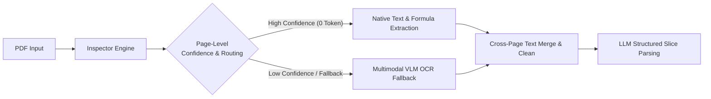
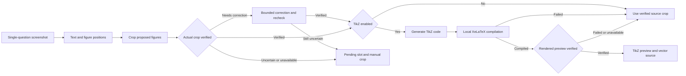
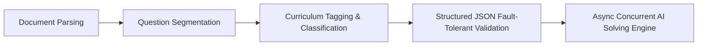

# MathBank - Localized Math Question Bank & Exam Layout Workbench

[中文](README.md) | [English](README_EN.md)

> **Project Tags**: Math Question Bank | High School Math | Lesson Prep & Teaching Research | A4 Layout Simulation | Intelligent Exam Generation | Gaokao-Level Export | Formula OCR | DeepSeek AI | EdTech

**MathBank** is a lightweight, semi-automated math question bank and exam paper layout workbench running entirely on your local computer, tailored specifically for secondary school mathematics teachers.

No frontend build step is required. The Windows 10/11 x64 portable package includes Python and its matching app-local VC++ Runtime and runs after extraction. The macOS package does not include Python, so confirm that Python 3.10 or newer is installed on the Mac before launching it; the launcher automatically detects it and creates or repairs the isolated project `venv`. MathBank supports second-level real-time preview of LaTeX formulas and geometric figures, deeply integrated with one-click exam paper creation, A4 simulation canvas layout, Gaokao-level PDF exam paper export, DeepSeek AI problem solving, and one-click formula OCR recognition.


---

## ✨ Key Highlights

With just basic LaTeX math formula syntax, MathBank empowers frontline math teachers to efficiently solve exam generation and lesson preparation challenges:

- 🎨 **1:1 A4 Simulation Exam Layout**: Provides an intuitive exam paper canvas just like Word, complete with sealing line, title, and notice box. Supports drag-and-drop sorting, question blank space height adjustment, and one-click switching to A3 answer sheet or Gaokao 19-question preset.
- ⚡ **Second-Level Formula Rendering & Exam-Level Export**: Built-in professional math formula typesetting engine with real-time web preview. Choice options adapt to 4, 2, or 1 columns according to their rendered widths. Long text wraps naturally in a single column; only an indivisible formula wider than its column scrolls horizontally, without reducing the font size. Question-bank, draft, and detail previews retain the complete stem, every option, and their pictures. Supports one-click export of high-definition PDFs matching National College Entrance Examination (Gaokao) standards and complete LaTeX source packages.
- 🤖 **AI Intelligent Exam Generation & Solving Assistance**: Built-in Large Language Models (DeepSeek, etc.) automatically select questions and generate exams based on knowledge point breakdown tables and difficulty gradients; supports single-question AI generation of detailed solutions and teaching reflections.
- 📚 **One-Click Switching Across Major Curriculum Outlines**: Natively preloaded with standard High School curriculum outlines: **PEP A (人教A版)**, **PEP B (人教B版)**, **Jiangsu (苏教版)**, and **Shanghai (沪教版)**. Changing outlines automatically and intelligently maps questions without manual re-organization.
- 📄 **Multi-Format Exam Smart Parsing & PDF Dual-Strategy Route**: Supports direct drag-and-drop of **LaTeX source (.tex)**, **Markdown (.md)**, **PDF exams (.pdf)**, or **Word documents (.docx)** for fast intelligent slice parsing. Markdown support is still experimental: carefully check each question, formula, image, and answer association before importing. PDF parsing natively offers dual strategies: **[Native Vector Text & Formula Extraction] (Default Recommended)** and **[Full-Page Visual OCR]**. Primary recommendation is native extraction using `PDF Inspector` for sub-second, 0-visual-token loss extraction; if images cause missing formulas, the system smoothly falls back to VLM visual OCR completion; full-page visual OCR and source-page review prompts remain available for unusually formatted exams; model output still needs to be checked against the original paper. Word import structurally converts Office OMML and parses MathType structures from OLE `Equation Native` streams, preserving preview images with manual audit tags for non-high-confidence formulas.

---

## 🤖 AI Agent / Harness Workflows

Source builds include a **Question Bank Assistant** for natural-language searches, question details, difficulty counts, and reviewed proposals to update tags, difficulty, explanations, or teaching reviews (up to 10 questions per proposal). It also proposes papers of up to 40 questions and deletions of up to 10 questions. Deletion proposals show affected papers and question references; questions containing images or TikZ assets are excluded. Replies render Markdown and math while streaming; explanation and teaching-review proposals include formatted previews and expandable source text. Chat can follow new output, pauses while you scroll back, and has a one-click scroll-to-bottom control. The conversation streams model and lookup progress, supports reading up to 10 questions together, and retains bounded query summaries for follow-up requests such as “organize those questions.” It uses the configured solving model and API key by default; question text included in a request is sent to that model. The assistant does not read images or change stems or curriculum classifications. Every proposal must be reviewed and explicitly confirmed; a verified full backup is created before a single-transaction write, and the whole proposal is rejected if any target question changed. Confirmed paper proposals create a saved paper that can be loaded into the paper workspace for further layout. Conversations stay in memory and are not restored after a refresh. This describes the current source build and does not imply that an existing official download package includes the feature.

MathBank features multiple highly automated, fault-tolerant, and self-healing AI Agent / Harness workflows to ensure high reliability across exam parsing, geometry redrawing, and concurrent solving:

### 1. PDF Parsing Harness


### 2. Single-Question OCR, Reviewed Crops & Optional TikZ

This flow applies to single-question screenshots. PDF and Word batch imports use their own extraction and review workflows.



### 3. Paper Ingestion & Concurrent Solving Harness


---

## 📝 Prerequisites & Environment Setup

- **LaTeX Local Compilation Environment Dependency**: Required ONLY if you need **TikZ geometry diagram redrawing** or **one-click HD PDF export**. If you only perform question entry, formula preview, searching, AI solving, and layout source package export, **no LaTeX installation is required**. If needed:
  * **macOS users**: Recommend installing [**MacTeX Official Website**](https://www.tug.org/mactex/) (Package ~5GB; Tsinghua University mirror recommended for fast download in China).
  * **Windows users**: Recommend installing [**TeX Live Official Website**](https://www.tug.org/texlive/) (ISO ~5GB; Tsinghua University mirror recommended; MiKTeX is also supported).
- **📄 Word (.docx) Exam Paper Safe Import**: No Microsoft Word or MathType installation needed. The system converts standard OMML formulas and uses `olefile` + MTEF v5 record trees to parse MathType structures; numbers like `32` and Latin letters like `p` won't be misidentified by legacy character rules. The system recursively preserves hyperlinks, tracked revisions, and Symbol characters, while extracting tables and original images. Preview images are kept for formulas without high-confidence conversion. The parser report details counts for structural conversion, embedded LaTeX, limited compatibility, and manual review needed.

### Preview & Single-Question OCR

- **Reviewed diagrams at their original positions**: Single-question OCR supports multiple diagrams in the stem, choices, and table cells. It checks the actual crop against the original screenshot. Any bounded box correction is cropped and checked again. With TikZ disabled, verified source crops stay at their original positions; no local LaTeX installation is needed for this cropping path. Unverified or unavailable crops leave a pending figure slot with a manual cropping entry. With TikZ enabled, the program can generate and compile drawing code, then check the rendered preview against the source. Drawing, compilation, or preview-verification failure falls back to a verified original crop. Figure verification adds model calls and waiting time; disabling TikZ still retains crop verification. These guarantees apply to single-question OCR, not automatically to PDF/Word batch imports.
- **Edits remain under your control**: Late responses from a previous recognition request or another question are not applied. If you edit while recognition is running, the current text remains and the result waits for you to select **Load recognition result (载入识别结果)**. If the text changes while a manual crop is open or uploading, the old insertion is rejected; reopen cropping to choose the correct position.
- **exam-zh upright constants**: Web previews support `\iu` / `\upi` for upright imaginary-unit i and `\eu` / `\upe` for upright natural constant e. Ordinary variables i/e stay italic. This preview compatibility does not rewrite the original text, database records, or export source.
- **Review images and curriculum labels**: Teacher-review images remain part of saving, drafts, and full backups. Curriculum knowledge remains a single value; when a unique subsection cannot be determined, the recommendation uses whole-chapter placement. Historical and custom classifications remain preserved.

---

## 🚀 Quick Start

### 📦 Option 1: Download Portable Package (Recommended for Non-Technical Users)

If you are unfamiliar with command line or Python environments, head to the [**Releases Page**](https://github.com/JudgePeach/math-question-bank/releases). Each archive is accompanied by a `.zip.sha256` checksum file; verify it before extraction:

* **Windows Users**: Use Windows 10/11 x64 and download `MathBank-Windows-x64.zip` (it includes the complete Python 3.10 and app-local VC++ runtimes; no separate runtime installation is required), extract it, and double-click **`启动题库系统.bat`**.
* **macOS Users**: Download `MathBank-macOS.zip`. **The macOS package does not include Python, so confirm that Python 3.10 or newer is installed on the Mac before launching MathBank.** The launcher automatically detects a supported Python and creates or repairs the isolated project `venv`; if none is found, it asks the user to install one and stops. Network access is required when the environment is first created or repaired; then double-click **`启动题库系统.command`**.

Both launchers check Python and required packages, and open an already-running MathBank service directly. Old PID/state files and Release manifests do not gate startup. Port conflicts and startup failures show the actual error and service log.

---

### 💻 Option 2: Run from Source

1. **Clone Repository**:
   ```bash
   git clone https://github.com/JudgePeach/math-question-bank.git
   cd math-question-bank
   ```

2. **Install Dependencies** (Python 3.10+ required):
   ```bash
   python -m pip install -r requirements.txt
   ```
   For development or tests, use `python -m pip install -r requirements-dev.txt`. Versions are locked; run the tests and `python -m pip check` when upgrading them.

3. **Launch Service**:
   * **Mac Users**: Double-click **`启动题库系统.command`**
   * **Windows Users**: Double-click **`启动题库系统.bat`**
   * **CLI Start**: Run `python -m uvicorn main:app --reload`, open browser at `http://127.0.0.1:8000`

   If another local application uses port 8000, save `{"port":8001}` in the project's `.system_generated/launcher-settings.json` and double-click the launcher. MathBank will use and open `http://127.0.0.1:8001`. The process environment variable `MATHBANK_PORT` overrides this setting. When running uvicorn directly, pass `--port 8001`. Give parallel applications separate fixed ports so polling and WebSocket reconnections from old pages reach the correct application.

> [!TIP]
> **PDF & Word Smart Parsing Recommendations**:
> 1. **PDF Strategy Selection**: Keep default **[Native Text & Formula Extraction]** mode when importing PDF exams for sub-second, 0-visual-token slice parsing; if image formulas cause missing items, VLM OCR auto-completes them; for heavily non-standard scanned documents, manually switch to **[Full-Page Visual OCR]** mode.
> 2. **Exam Content Recommendation (Avoid Token Limit Exceeded)**: For both **PDF** and **Word (.docx)** imports, to avoid exceeding LLM single Context Window / Token limits on extremely long exams, it is strongly recommended to prioritize exams with **questions only (no lengthy detailed solutions)**.

---

## 🔑 API Configuration & LLM Selection Guide

Whether running from source or portable packages, AI tasks rely on external APIs. After launching, click the **Settings (Gear Icon)** button in the top right corner of the web interface to save API keys and configure the provider and model separately for solving, paper parsing, classification, OCR, and drawing:

### 1. 🤖 Pure Text LLM Reasoning (Solving / Parsing / Classification)
Configure the text-task provider and model separately from OCR. The program provides **DeepSeek Flash** and **DeepSeek V4 Pro** presets for text tasks such as solving, paper parsing, and classification, using the existing [DeepSeek Official Open Platform](https://platform.deepseek.com/) API-key configuration. Refer to the provider's current model documentation for availability, supported inputs, and pricing.

### 2. 📷 Default Formula OCR Model (Must use Multimodal VLM)
* **Use an image-capable model**: OCR reads screenshots. A text-only task configuration cannot perform image recognition.
* **DeepSeek official OCR**: In **Settings**, choose **DeepSeek** as the OCR provider and **`deepseek-flash`** as the OCR model. This reuses the existing DeepSeek official API key; no separate OCR key is needed. **`deepseek-v4-pro`** is not the official OCR preset.
* **Other existing providers**: The program includes [SiliconFlow](https://cloud.siliconflow.cn/i/hkgjSWrg) and [Aliyun Bailian](https://bailian.console.aliyun.com/) integrations. The SiliconFlow OCR preset includes `Qwen/Qwen3-VL-8B-Instruct`; Bailian presets use `qwen3.7-flash` for routine OCR, paper parsing, and classification, and `qwen3.7-plus` for solving and drawing. Choose models that the platform actually offers, confirming image-input support for OCR. Trial credits, free quotas, prices, and model capabilities are subject to each platform's current published terms.

### 3. 🎨 TikZ Geometry Diagram Redrawing Model (`PREFER_DRAW_MODEL`)
Choose the drawing model through the existing provider configuration, using the provider's current model list and supported inputs. Generated code and compiled diagrams still need to be checked against the original; enabling TikZ does not guarantee an accurate redraw. You can disable TikZ to use reviewed original-image crops instead.

> [!WARNING]
> **Disclaimer Regarding Third-Party API Relay Services**
> 
> The two third-party API relay links provided below are listed **solely because the developer uses them personally in daily workflow, and no guarantees or warranties are made regarding their service stability, model authenticity (watered-down/replaced models), or data privacy/security**. Third-party aggregators may pose data leak, privacy, or model substitution risks. Use with caution:
> * **Multimodal Aggregator A**: [RightCodes Registration Link](https://www.rightapi.ai/register?aff=f7656b31). Check its current supported models, capabilities, and pricing.
> * **Multimodal Aggregator B**: [PackyAPI Registration Link](https://www.packyapi.com/register?aff=5yyF). Check its current supported models, capabilities, and pricing.

> [!IMPORTANT]
> **Regarding TikZ Auto Geometry Redrawing & Local LaTeX Environment Dependency**
> 
> The AI intelligent TikZ geometry redrawing and PDF exam compilation/rendering features rely heavily on your **locally installed LaTeX typesetting environment** (such as **MacTeX** on macOS, **TeX Live** or **MiKTeX** on Windows).
> Make sure `pdflatex` and `xelatex` commands can be invoked from your terminal (i.e. LaTeX toolchain added to system `PATH`). If not installed locally, AI-generated TikZ code and LaTeX source code are still saved and exported intact, but background PDF compilation will be restricted.

## 🔄 Version Upgrade & Data Backup

### Upgrade Methods

- **✨ In-App One-Click Update Check & Portable Direct Link**: Built-in automatic version detection. Go to top-right 【Settings】$\rightarrow$【Version Updates】to compare against GitHub Releases, view release notes, and download portable packages directly, or ignore updates.
- **Method A: Git Upgrade (Recommended for Source Users)**

  1. Save your current edits and create a verified full backup.
  2. Use the webpage power button to shut MathBank down and wait until the service has stopped.
  3. Update the source:
  ```bash
  git pull
  ```
  4. Launch again and check the version in Settings. Resolve any source-update conflicts before launching.

  Databases (`*.db`), API keys (`.env`), dimension configurations (`data_backup/`), and illustrations (`static/uploads/`) are Git-ignored. These ignore rules do not prevent database migrations when the updated program starts, and do not replace a backup or rollback plan.

- **Method B: Portable Package Overwrite Upgrade**
  1. Create a verified full backup first (see **Full Backup and Restore** below).
  2. Use the power button in the top-right of the web page to shut MathBank down safely, and wait until the page confirms that the service has stopped. Never overwrite files while the backend is running.
  3. Extract the new ZIP into a **separate temporary directory**, not directly into the existing installation.
  4. **Windows:** open the extracted folder, select all of its *contents*, copy them into the existing installation, and replace every same-named file when prompted.
  5. **macOS Finder:** press `Command + Shift + .` first so hidden files such as `.env.example` are visible, then copy all *contents* of the extracted folder into the existing installation and merge same-named directories. **Do not choose Replace for the entire project folder**; Finder may remove local files that exist only in the old folder.
  6. Double-click the new launcher to prepare dependencies and open MathBank. Startup no longer checks historical Release manifests or deletes old release files. If the old version is still running, stop it using the webpage power button, then launch again.

  Overlay upgrades preserve root databases and their WAL/SHM files, `.env`, `data_backup/`, `static/uploads/`, `.system_generated/`, and `venv/`. Never delete the existing installation and replace it with the new folder. The Windows 10/11 x64 portable package includes its complete Python and VC++ runtimes, so no separate runtime installation is required. The macOS package does not include Python, so confirm that Python 3.10 or newer is installed on the Mac before launching it. The macOS launcher automatically creates or repairs `venv`; network access is needed only when the environment is first created or when `requirements.txt` changed/dependencies are missing.

### Database Upgrades & Rollback

Supported released versions can be upgraded directly, without installing each intermediate version. Only when the database structure needs migration does the program first create and verify a database snapshot in `data_backup/schema_snapshots/`. That automatic snapshot contains **only the database**. Create a full backup separately before upgrading to preserve referenced illustrations and custom metadata as well.

**Rollback**: Completely stop the service, then restore the pre-upgrade full backup and use the corresponding older application. Replacing program files alone does not undo a migrated database, and an older program should not be started against a newer database structure. Preserve a separate copy or export of any edits made after the backup before rolling back; restoring the earlier backup will not include those later edits. Keep `.env` separately, since full backups exclude API secrets. Database structure numbers and software versions are managed separately; upgrading does not automatically reclassify historical questions.

> [!IMPORTANT]
> **Data Backup Recommendation**
> 
> A verified full backup is the preferred safeguard before either upgrade method. Automatic pre-migration database snapshots contain **only the database**; a full backup also preserves referenced illustrations and custom metadata. For an additional manual copy, preserve these files/directories:
> - `*.db` (Local Question Database)
> - `.env` (API Key Config)
> - `data_backup/` (Custom Dimensions & Curriculum Outlines)
> - `static/uploads/` (Uploaded Illustrations & Geometry Figures)

---

## 🛠️ CLI Search & Utility Scripts

### 1. Fast Local Terminal Search (`scripts/search_questions.py`)
Quickly search the question bank from terminal (e.g. search "derivative"):
```bash
python3 -m scripts.search_questions -q "导数"
```
**Parameters**: `-q` keyword | `-n` return count (default 50, `-1` unlimited) | `-a` include answers/solutions | `-t` filter type | `-d` filter difficulty | `-r` search associated questions

### 2. Data Cleaning & Self-Healing Scripts
- **Fill-in-the-blank Underline Upgrade**: `python3 -m scripts.migrate_fillin` (Standardizes old underlines to `\fillin` macro)
- **Multiple-Choice Empty Parentheses Cleanup**: `python3 -m scripts.migrate_choice_parentheses` (Cleans trailing empty parentheses in stems to avoid overlap with `\paren`)
- **Build Cross-Platform Release (Source Repository Only)**: In the source repository, confirm the version in `mathbank/__init__.py`, then run `python3 -m scripts.build_release`; portable packages do not include the builder. The builder verifies pinned SHA-256 values for the official Python/NuGet runtimes, the Release allowlist, runtime layout, and a source smoke check. It emits an in-archive `RELEASE-MANIFEST.json` and an external `.zip.sha256` file.

### 3. Full Backup and Restore

```bash
# Create a verified backup of the database, uploads, and custom metadata
python3 -m scripts.backup

# Verify only; this does not modify current data
python3 -m scripts.restore data_backup/snapshots/mathbank-backup-TIMESTAMP.zip

# Restore for real: completely stop MathBank first
python3 -m scripts.restore data_backup/snapshots/mathbank-backup-TIMESTAMP.zip --apply --yes
```

Full backups include the database, referenced illustrations, custom metadata, and a per-file SHA-256 manifest; they exclude `.env`, the local token, and API secrets. The server and restore tool share a cross-platform runtime lock, so restore refuses to run until the service is fully stopped. `questions_backup.json` is a compatibility JSON export for search/sync; it is not a disaster-recovery backup.

---

## 📂 Source Repository & Portable Package Contents

The tree below describes the **source repository** and its runtime data locations. Portable ZIPs contain the allowlisted application and normal user components, including launchers, offline preview resources, templates, search, backup, and restore tools. Development-only and one-off internal tools, `tests/`, `docs/`, and `scripts/build_release.py` are excluded. Source documentation and developer tools shown below are therefore not a portable-package file list. Runtime data and credentials are created locally or preserved during upgrades; they are not shipped in the ZIP.

```text
.
├── data_backup/                # Real-time backup & AI read-only library (Git ignored)
│   ├── archive/                # Historical migrations & database archives
│   ├── snapshots/              # Verified full-recovery archives
│   ├── schema_snapshots/       # Standalone pre-migration snapshots and SHA-256
│   ├── questions_backup.json   # Question JSON sync export (not a full backup)
│   └── questions_library.md    # AI-exclusive read-only question bank (solutions filtered)
├── docs/                       # Project documentation & README preview images
│   ├── AI_DATABASE_GUIDE.md    # AI question bank search guide
│   └── images/                 # Product interface preview screenshots
├── mathbank/                   # Backend domain package
│   ├── database.py             # SQLite data models & Session
│   ├── db_migrations.py        # Versioned, backup-first SQLite migrations
│   ├── backup.py               # Full backup, verification, restore & rollback
│   ├── asset_security.py       # Upload validation & local asset boundary
│   ├── task_manager.py         # Bounded tasks, cancellation & asset lifecycle
│   ├── health.py               # Startup readiness & database health
│   ├── paper_helper.py         # LaTeX/PDF compilation, layout & LRU cache
│   ├── sync_helper.py          # JSON sync export & AI library sanitizer
│   ├── paths.py                # Single source of truth for project paths
│   ├── curriculums.py          # Preset loader for 4 curriculum outlines
│   ├── prompts.py              # Prompt builder for OCR/solve/parse/TikZ/paper
│   ├── ai_providers.py         # AI provider & model parameter parsers
│   ├── ai_http.py              # AI HTTP requests & authentication
│   ├── ai_json.py              # AI structured JSON fault-tolerant parser
│   ├── ocr_illustrations.py    # Single-question figure slots & crop materialization
│   ├── ocr_figure_review.py    # Actual crop & TikZ-preview verification
│   ├── ocr_raster_layout.py    # Bounded pixel-layout evidence & box corrections
│   ├── latex_diagnostics.py    # XeLaTeX error diagnosis & AI solver
│   ├── content_locks.py        # Word formula inline visible locking & verification
│   ├── omml_helper.py          # Office OMML structured formula converter
│   ├── mtef_helper.py          # MathType OLE/MTEF v5 parser & diagnostics
│   ├── docx_helper.py          # Word text/table/image extractor & report
│   ├── pdf_inspector_helper.py # PDF Inspector vector text extraction
│   └── resources/curriculums/  # Shared JSON outlines for A/B/S/H editions
├── scripts/                    # Maintenance, migration, search & release tools
│   ├── search_questions.py
│   ├── backup.py
│   ├── restore.py
│   ├── migrate_fillin.py
│   ├── migrate_choice_parentheses.py
│   └── build_release.py        # Source-only builder; excluded from portable ZIPs
├── static/                     # Frontend static assets
│   ├── index.html              # Main dashboard frontend SPA
│   ├── css/                    # Offline styles for Tailwind, FontAwesome, KaTeX
│   ├── uploads/                # Unreferenced images enter recoverable retention
│   └── js/                     # Cascading frontend JS modules
│       ├── api.js              # API interaction & Token interceptor
│       ├── editor.js           # Editing, KaTeX preview & TikZ compilation
│       ├── ocr.js              # Formula OCR recognition & interaction
│       ├── import.js           # Exam paper parsing & draft/question list
│       └── paper.js            # Exam paper workbench & Live Preview engine
├── templates/                  # LaTeX templates & exam-zh macro package library
├── tests/                      # Pytest automated testing & artifacts
├── main.py                     # FastAPI service entry point & routing
├── math_question_bank.db       # Local SQLite database (retained for backward compatibility)
├── 启动题库系统.bat            # Windows one-click start script
├── 启动题库系统.command        # macOS one-click start script
├── README.md                   # Chinese documentation
├── README_EN.md                # English documentation
├── requirements.txt            # Python dependencies
├── requirements-dev.txt        # Development & testing dependencies
└── .env.example                # Environment variable configuration template
```

---

## 📄 Open Source License

This project is open-source under the [GNU AGPLv3](LICENSE) license.
